# 家用電器能源消耗預測：多元線性回歸、特徵選擇與自回歸延伸

**5115056030｜HW2 正式報告｜CRISP-DM 六階段｜2026 年 10 月**

**資料集：** Appliances Energy Prediction（Kaggle／UCI）　**研究問題：**以同期環境及照明資訊估計 10 分鐘家電耗電（Wh），並比較加入實際歷史耗電的 ARX 線性回歸。

> **研究倫理與評估聲明**：Train/Validation/Test 按時間切分；所有 scaler、feature selector 與線性模型只在 Training 擬合；根據 Validation RMSE 選擇最佳純環境模型。Test 不用於挑選模型。OL​​S 傳統 PI 需獨立、常態、等變異等假設，不能當成已校準的警報界限。本文的原論文數值與本研究使用不同資料切分，**僅供背景比較**，不可解讀為同場排名。最終 GPT 對話完整匯出 PDF 需由學生在 ChatGPT 介面另行完成。

## 摘要

研究使用 19,735 筆、每 10 分鐘一次的低能耗住宅量測資料，原始 29 欄中排除日期及目標後有 27 個數值特徵。資料無缺失，但 `rv1`、`rv2` 完全重複且屬人工隨機控制變數，故主要實驗保留 25 個感測與氣象候選特徵。以時間順序劃分 Training 13,814、Validation 2,960 及 Test 2,961 筆。在 Training 範圍內比較 SelectKBest、RFE、SFS、Lasso 和 Permutation Importance，分別選 14／20／25 特徵，搭配 LinearRegression、Ridge、Lasso 共 45 種組合。Validation 最佳是 Permutation Importance 14 特徵的 LinearRegression（RMSE 84.71 Wh），在 Test 上 RMSE 89.20 Wh、R² 0.0366。預先定義的延伸實驗加入前 10／20／30 分鐘的實際耗電值（總共 28 特徵），在同一 Test 上 RMSE 61.40 Wh、R² 0.5435，殘差 Durbin–Watson 從 0.583 提高到 2.070；但仍存在異質變異、厚尾與高 VIF。傳統 95% OLS PI 整體涵蓋率約 95.47%，高耗電 >400 Wh 僅約 24.64%，不宜直接做安全告警門檻。部署模組已實際儲存／讀取 Pipeline，並針對基載與高峰負荷示範 95% PI 與係數貢獻。

## 1. Business Understanding（商業理解）

住宅 HEMS（Home Energy Management System）需要估計家庭設備於每個 10 分鐘觀測視窗的耗電，協助儀表板顯示、感測器一致性檢查與負荷變化觀察。研究優先採 **`sklearn.LinearRegression`**：目的不只是提高 R²，也要維持透明可解釋的輸入、係數與統計診斷。方案 A 使用同期溫濕度、氣象及照明量測估計 `Appliances`，**不是預先預報未來**；方案 B 進一步利用已實測的前一至前三個時間點電器耗電（ARX）提供連續更新的即時估計。兩個方案在生產端所需資訊不同，實際效果不可不加條件地相互替代。

**成功準則：**提供可重現的數據切分、5 種特徵選擇與回歸模型評估；比較 MAE、MSE、RMSE、R²、Adjusted R²；完成五大回歸假設、95% CI／PI、涵蓋率及實際推論示範。與企業需求連結但不宣稱已於實際住宅上線。

## 2. Data Understanding（資料理解）

資料來源：[Kaggle](https://www.kaggle.com/datasets/loveall/appliances-energy-prediction)、[UCI](https://archive.ics.uci.edu/dataset/374/appliances+energy+prediction)。取樣時段為 2016/01/11 17:00 至 2016/05/27 18:00，連續每 10 分鐘一筆，共 **19,735 × 29**，缺失儲存格 0、完全重複資料列 0、重複時間點 0。原始數值候選特徵 27 個（照明 1、`T1–T9` 及 `RH_1–RH_9` 共 18、天氣 6、隨機欄位 2）；目標 `Appliances` 不納入特徵數。

`Appliances` 平均 **97.69 Wh**、中位數 **60 Wh**、Q1 **50 Wh**、Q3 **100 Wh**、最大 **1,080 Wh**。IQR 上界 175 Wh，超過的高負荷記錄 **2,138 筆（10.83%）**，不逕自刪除。`rv1` 與 `rv2` 每筆完全一樣；溫度 `T6` 與 `T_out` 的 Pearson r 約 0.9748。單一變數與目標最大的 r 是 `lights` 約 +0.1973，無法僅靠單變量關係判斷多元模型能力。目標相隔 10 分鐘的自相關 r 約 0.753，故不能任意打散 Train/Test。

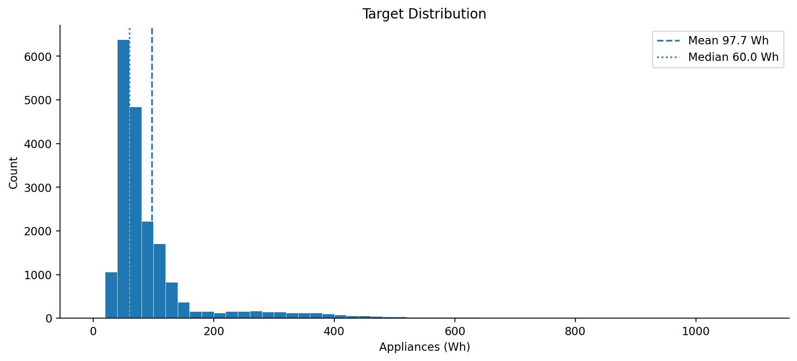

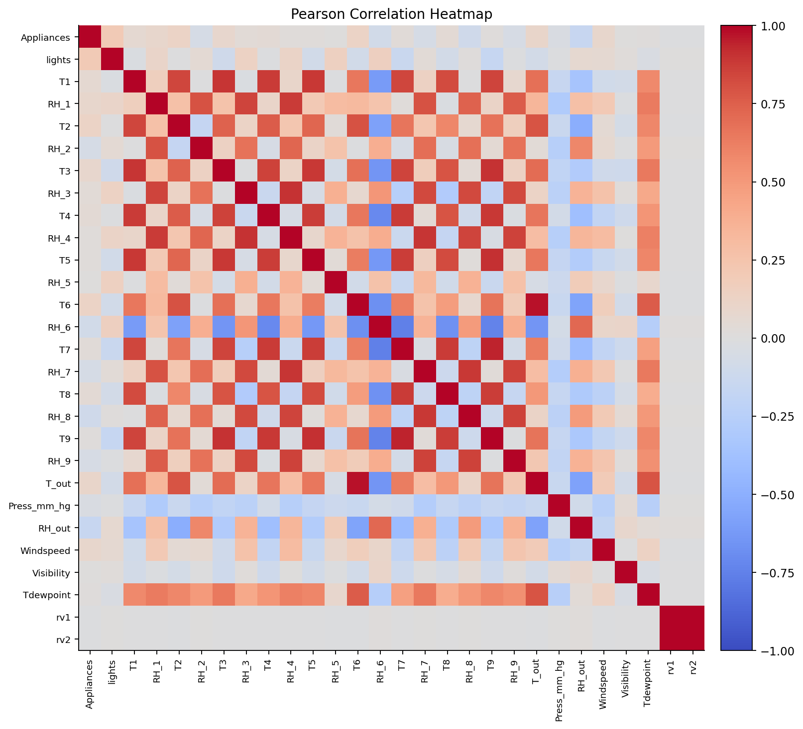

## 3. Data Preparation（資料準備）

原始欄位 29 個，排除 `date`（只用來排序）、`Appliances`（目標）及 `rv1`、`rv2`（已知無意義的重複隨機對照欄位），保留 **25 個數值候選特徵**。不填補缺失值、不刪除尖峰。主 `LinearRegression` 不需要為尺度而標準化，但為公平比較 Ridge／Lasso 與一致推論，**僅以 Training 呼叫 `StandardScaler.fit`**，Validation/Test 僅用 `transform`。SFS 的交叉驗證各折於折內 fit scaler；Permutation Importance 在 Training 內另做時間 holdout。

| 時間分割 | 筆數 | 時間範圍 | 用途 |
| --- | --- | --- | --- |
| Training (70%) | 13,814 | 2016/01/11–04/16 | 特徵選擇、標準化、擬合 |
| Validation (15%) | 2,960 | 2016/04/16–05/07 | 選超參與最佳模型 |
| Test (15%) | 2,961 | 2016/05/07–05/27 | 最終一次評估、模型診斷 |

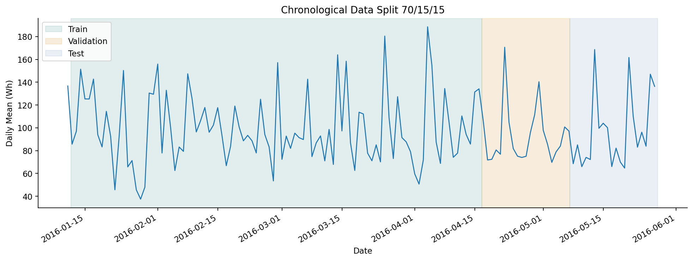

由於 Validation/Test 時段晚於 Train，此方式主要衡量時間外推能力；照明為 0 的比例亦由 Train 73.28% 升至 Test 88.25%，顯示分布漂移。**觀測到 Test 的分布不代表允許用它調整模型。**

## 4. Feature Selection & Modeling（特徵選擇與建模）

在 25 個候選特徵中，訓練期間執行 SelectKBest（f-regression）、RFE、SFS（訓練區間 3 折 TimeSeriesSplit）、Lasso 係數排序及 Permutation Importance（Train 內部 80/20 時序 holdout），選擇 14、20、25 個特徵；每一組分別訓練 LinearRegression、Ridge（alpha=10）、Lasso（alpha=0.1）。總數 5 × 3 × 3＝**45 組**。k=25 為完整候選基線，雖仍列示方法，實際沒有刪除特徵。最佳組合僅按 Validation RMSE 排序；其他隨機步驟固定種子 42。

| Validation 排名 | 方法 | k | 模型 | RMSE (Wh) | R² |
| --- | --- | --- | --- | --- | --- |
| 1 | Permutation | 14 | LinearRegression | 84.71 | 0.1566 |
| 2 | Permutation | 14 | Ridge | 84.91 | 0.1526 |
| 3 | SFS | 20 | Lasso | 85.16 | 0.1477 |
| 4 | SFS | 20 | Ridge | 85.20 | 0.1468 |
| 5 | SFS | 20 | LinearRegression | 85.24 | 0.1459 |
| 6 | Permutation | 20 | LinearRegression | 85.24 | 0.1459 |
| 7 | Permutation | 20 | Ridge | 85.37 | 0.1434 |
| 8 | Permutation | 14 | Lasso | 85.37 | 0.1434 |
| 9 | Permutation | 20 | Lasso | 85.70 | 0.1368 |
| 10 | RFE | 14 | Ridge | 86.19 | 0.1268 |

**被選中的 14 個特徵：** `lights`, `RH_1`, `T2`, `RH_2`, `T3`, `RH_3`, `T6`, `RH_6`, `T7`, `T8`, `RH_8`, `T_out`, `RH_out`, `Tdewpoint`。其最大 VIF **382.45**，顯示特徵選擇改善 Validation RMSE 並不代表共線性已消除。個別係數不可隨便解讀為因果效果。

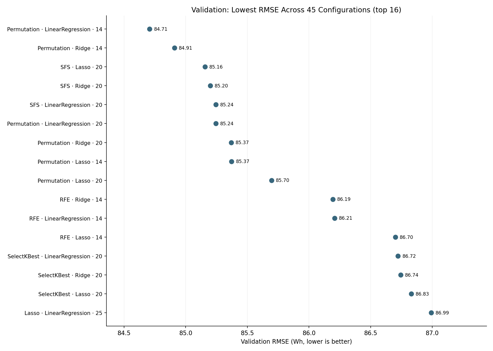

### 4.1 比較模型：加入歷史耗電的 Auto Regression

在**資料切分之前**先為每個時間點建立 `Appliances_lag1`, `Appliances_lag2`, `Appliances_lag3`，然後依原本日期切分，這三欄分別使用 t−1、t−2、t−3 的**實際觀測值**，不可直接使用當期 Target。移除資料開頭 3 筆無 lag 的觀測後，B 的 Train 是 13,811 筆，但 Validation/Test 均保持原 2,960／2,961 筆。使用同樣對齊後的 Train 建立 25 環境特徵控制模型與 28 特徵 ARX 模型，以完全相同 Test 列公平比較。

| 對照組 | 分割 | 特徵數 | MAE | RMSE | R² |
| --- | --- | --- | --- | --- | --- |
| Env-25 | Validation | 25 | 54.52 | 86.96 | 0.1111 |
| Env-25 | Test | 25 | 57.51 | 88.25 | 0.0570 |
| Env+3lag-28 | Validation | 28 | 28.86 | 60.68 | 0.5672 |
| Env+3lag-28 | Test | 28 | 28.85 | 61.40 | 0.5435 |

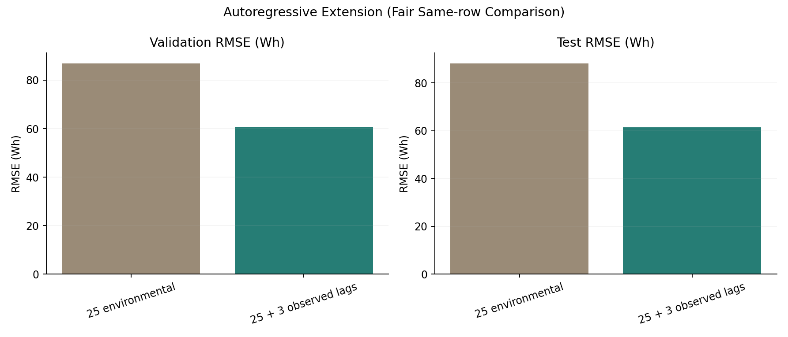

## 5. Evaluation（深入評估）

**Best Model A 14 特徵的 Test 結果：** MAE 60.17、MSE 7,955.90、RMSE **89.20 Wh**、R² **0.0366**、Adjusted R² **0.0320**。**方案 B 28 特徵 Test 結果：** MAE 28.85、MSE 3,769.77、RMSE **61.40 Wh**、R² **0.5435**、Adjusted R² **0.5391**。OLS 作為與鎖定的 scikit-learn 模型數值等價的 Train-only 擬合，用 `statsmodels.get_prediction(...).summary_frame(alpha=0.05)` 取得平均 95% CI 與個別 95% PI；**沒有**用 Test 重新估計回歸係數。

| Test 殘差指標 | A-14 | Env-25 | B-28 |
| --- | --- | --- | --- |
| DW | 0.5831 | 0.5955 | 2.0704 |
| ACF lag1 | +0.6876 | +0.6892 | -0.0359 |
| BP LM | 254.53 | 285.67 | 286.23 |
| BP p | 3.32e-46 | 4.44e-46 | 1.31e-44 |
| Skewness | 3.157 | 2.960 | 3.211 |
| Excess kurtosis | 14.122 | 13.063 | 21.691 |

### 5.1 五大假設

1. **線性形式：** Residuals vs Fitted Values 出現不同預測負荷下的殘差形態與尖峰，線性條件平均假設可能不足；圖形只提供診斷，不可直接視為已形式檢定通過。
2. **獨立性：** A-14 Test DW **0.5831**，殘差具強烈正自相關；加入 lag 的 B-28 Test DW **2.0704**，一階 ACF 約 −0.0359，改善明顯，其他延遲仍需另看 ACF。
3. **等變異：** Breusch–Pagan Test p 值極小（例如 B 約 1.31e−44），**拒絕同質變異的虛無假設**。
4. **常態性：** Q–Q Plot 與 Histogram 厚尾；Jarque–Bera／Omnibus 檢定拒絕常態，對常態建構的 PI 必須保守解釋。
5. **多重共線性：** Training VIF 最大 A-14 **382.45**、B-28 **405.34**；篩選後仍有高度相依特徵，個別係數具不穩定風險。

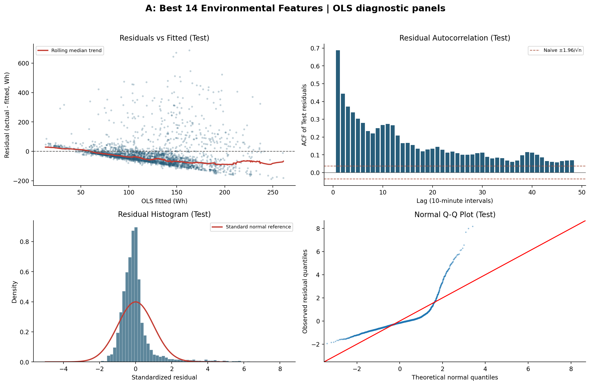

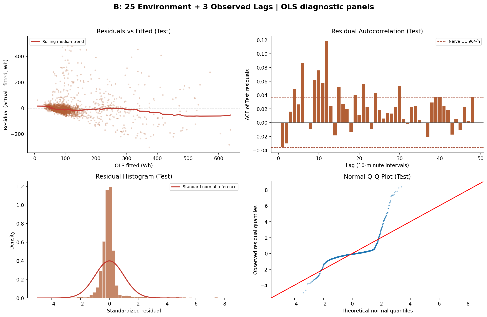

### 5.2 預測區間與涵蓋率

95% CI（**條件平均值**）比 95% PI（**單筆實際耗電**）狹窄。PI 由 OLS 傳統 iid-normal 公式取得，沒有對變異不齊與時間相關做區間校準。圖中同時呈現 Actual、Predicted、95% CI、95% PI，並特別放大 Test 首 432 筆（72 小時）。

| 涵蓋率統計 | A-14 | B-28 |
| --- | --- | --- |
| Test PI Coverage | 96.49% | 95.47% |
| 平均 PI 寬度 (Wh) | 384.21 | 268.07 |
| PI 下界小於 0 | 95.47% | 87.20% |
| >400 Wh 涵蓋率 | 0.00% | 24.64% |

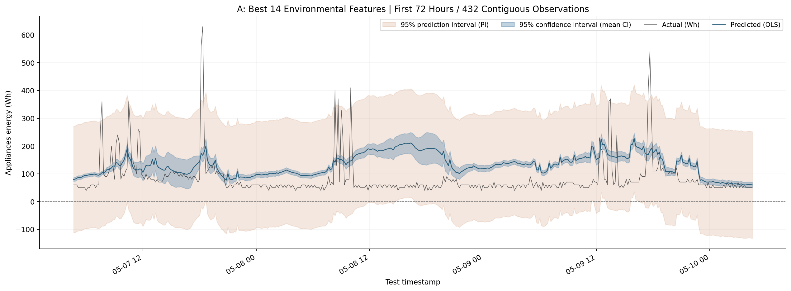

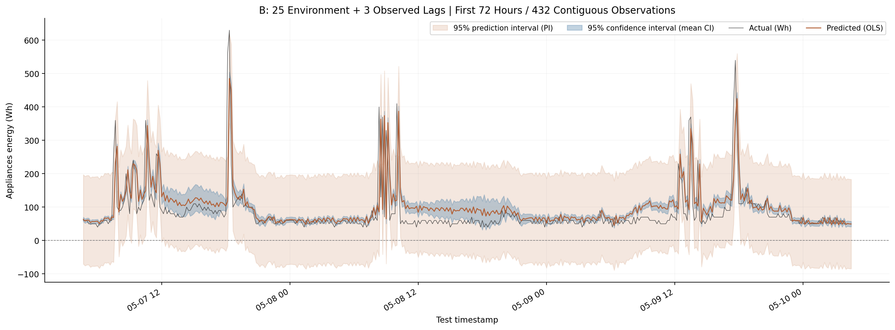

**關鍵限制：**當低負荷占多數時，整體 Coverage 接近 95% 不表示高負荷可靠。傳統線性 PI 大量出現負下界（耗電量物理上不可為負），且對 >400 Wh 尖峰的覆蓋率很低。假如將此 PI 直接當自動警報閾值，容易高估其可信度。改善方向為異方差／分位數迴歸、時間依賴校準與分組 Coverage 驗證，尚未在此作業實作，不得宣稱已完成。

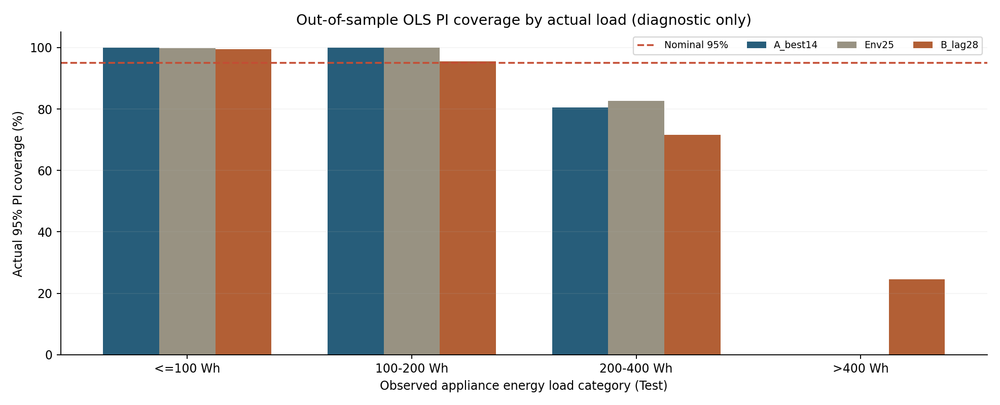

## 6. Deployment（模型部署與新樣本推論）

已將鎖定 Step 4 的 scaler、14 個特徵選擇器及 LinearRegression 包成可由 `joblib.load` 載入的 `sklearn.Pipeline`（方案 A）；方案 B 為 scaler + 28 特徵 LinearRegression Pipeline。**沒有使用 Test 重新擬合 scaler／特徵／模型**；只使用原 Training 的觀測重新建立數值等價的 `statsmodels.OLS`，用於傳統 CI/PI 推論。載入存檔 Pipeline 後逐筆檢查，與原鎖定模型預測值一致。需注意：`joblib.load` 使用 pickle 機制，只能載入可信來源檔案。

### 6.1 低負荷與尖峰樣本實測

從 Test 中以實際負荷與照明選取 3 筆低負荷、3 筆已發生尖峰作**事後展示**，不作模型選擇或調參。若實際系統部署，不能依未觀測的真實 `Appliances` 先選樣本。

| 日期／情境 | Actual | 模型 | 點預測 (Wh) | 95% PI 下界 | 95% PI 上界 |
| --- | --- | --- | --- | --- | --- |
| 2016-05-07 04:40／低負荷 | 60 | A-14 | 79.56 | -112.25 | 271.37 |
| 2016-05-07 04:40／低負荷 | 60 | B-28 | 63.40 | -70.37 | 197.16 |
| 2016-05-07 04:50／低負荷 | 60 | A-14 | 80.66 | -111.15 | 272.46 |
| 2016-05-07 04:50／低負荷 | 60 | B-28 | 58.15 | -75.61 | 191.91 |
| 2016-05-07 05:00／低負荷 | 60 | A-14 | 84.07 | -107.73 | 275.87 |
| 2016-05-07 05:00／低負荷 | 60 | B-28 | 60.94 | -72.82 | 194.70 |
| 2016-05-07 18:10／已觀測尖峰 | 560 | A-14 | 173.41 | -19.62 | 366.44 |
| 2016-05-07 18:10／已觀測尖峰 | 560 | B-28 | 118.05 | -16.63 | 252.73 |
| 2016-05-09 17:40／已觀測尖峰 | 540 | A-14 | 181.83 | -11.22 | 374.88 |
| 2016-05-09 17:40／已觀測尖峰 | 540 | B-28 | 359.18 | 224.34 | 494.03 |
| 2016-05-13 08:00／已觀測尖峰 | 660 | A-14 | 153.15 | -38.81 | 345.10 |
| 2016-05-13 08:00／已觀測尖峰 | 660 | B-28 | 488.30 | 354.18 | 622.42 |

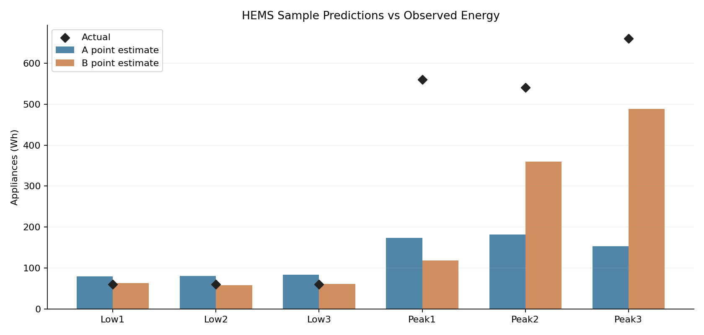

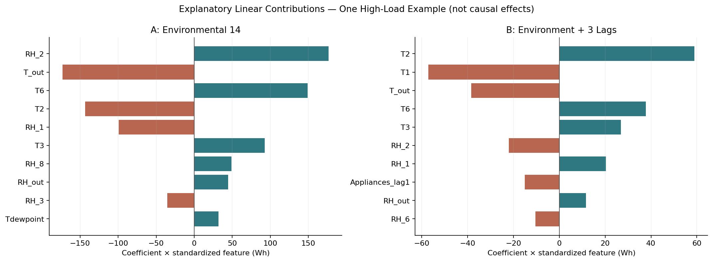

**係數貢獻解釋：**對經訓練期平均／標準差標準化的特徵，單筆預測可寫成 `intercept + Σ(coef_i × z_i)`，其中 `z_i=(x_i − TrainMean_i)/TrainSD_i`。每個貢獻項及原值皆已輸出 `demo_feature_contributions.csv`。由於特徵共線性高，係數貢獻只描述此模型運算結果，不代表改變單一室溫會因果改變該幅度的耗電量。

### 6.2 HEMS 系統情境、操作限制與風險

- **方案 A**：感測器溫濕度／氣象與同期照明量測已經取得時，估計同一時段的電器負荷，可用於基載趨勢探索、缺值合理性初判或感測器訊號異常的輔助指標，但其低 Test R² 與高峰失準使其**不適合單獨**做關鍵安全判斷。
- **方案 B**：若有真實時間序列電表，系統可保留最近 3 個 10 分鐘時段的 `Appliances` 實測值，結合同期其他感測器提供**連續更新的負荷估計／輔助預警**。**需先取得滯後用電量**，沒有真實滯後數據不得把當期預測值冒充歷史測量值；如果連續遞迴預測須另做多步驗證。
- **輸入管控**：按 `deployment_schema.json` 的 feature order、單位及數值型態送入，禁止將 Target 或 `date` 當環境特徵；日期用來排序與 lag 對齊。必須監測時間間隔、遺漏值、感測器故障及跨季節分布漂移。
- **PI 警告**：大量負下界與負荷尖峰 coverage 不足，不能將傳統 OLS PI 直接當作具有 95% 校準保證的警報區間；展示時可以保留負值說明模型限制，但實務呈現應另行設計物理限制與校準方法。

### 6.3 實際部署輸出

`5115056030_step6_outputs/HEMS_environment_14_pipeline.joblib` 和 `HEMS_lag_28_pipeline.joblib` 可供再次載入推論；`deployment_schema.json` 定義欄位順序；`demo_predictions_95PI.csv` 收錄個別 CI／PI；`demo_feature_contributions.csv` 收錄所有標準化係數貢獻與截距；PNG 是本研究實測結果。專案主程式 `5115056030_hw2.py` 亦能從原始 CSV 重新執行六階段。

## 7. 學術來源、NotebookLM 研究與方法對照

### 【NotebookLM 摘要】網路同主題解法與原始文獻研究

> 本研究透過 Google NotebookLM 彙整 UCI 原始文獻（Candanedo et al., 2017）與 Kaggle 社群高分公開解法。
>
> 1. **問題背景與特徵特性**：本研究資料集涵蓋低能耗住宅 4.5 個月之室內溫濕度（`T1`~`T9`、`RH_1`~`RH_9`）、室外氣象與兩個無關隨機變數（`rv1`, `rv2`）。目標變數 `Appliances` 呈強烈右偏分布（待機基載約 40~60 Wh，尖峰高達 1,080 Wh）；且特徵存在嚴重多重共線性（如 `rv1` 與 `rv2` 完全共線、室內外溫濕度高度相關）。
> 2. **傳統線性回歸瓶頸**：單純利用環境溫濕度進行 OLS、Ridge 或 Lasso 多元線性回歸時，測試集解釋力（$R^2$）僅約 0.05~0.16。主因是家電開關屬非線性階躍變化，線性模型無法捕捉突發尖峰，且殘差具強烈正自相關與異質變異，嚴重違反了傳統回歸假設。
> 3. **特徵工程與選擇**：主流解法透過 RFE 或 Lasso 成功剔除無統計顯著性的隨機變數（`rv1`, `rv2`）。加入時間週期特徵（如距離午夜秒數 NSM、小時）能捕捉居民日常作息規律；導入自回歸**滯後項（Lag features）**則顯著利用相鄰時間的強慣性，使線性模型的 $R^2$ 躍升至 0.55~0.60 以上。
> 4. **主流與更優解法比較**：相較於線性模型，非線性集成樹模型（如 Random Forest、GBM 與 XGBoost）能自動學習時間與溫濕度的非線性交互作用，測試集 $R^2$ 提升至 0.57 以上（RMSE 降至約 66 Wh），大幅突破傳統回歸之預測瓶頸。

**摘要來源說明：**以上四項為學生本人提供的 **Google NotebookLM 研究摘要原文**，由 GPT 協助排版。下方原始論文數字另有逐頁核實；摘要中的概括值不全都對應本研究或原論文的同一模型與資料切分，請以各表格標註的來源為準。NotebookLM 原始筆記連結及問答畫面目前未提供，需由學生自行保存佐證。特別是：本研究的 Lag Test $R^2=0.5435$（未達「0.55 以上」）；原始論文 RF Test $R^2=0.54$，不是全部樹模型都超過 0.57；原論文並**未**在其四模型比較中報告 XGBoost。`rv1` 和 `rv2` 是我們於建模前依已知隨機欄位排除，不能宣稱其由本研究 RFE/Lasso 自動剔除。

### 本研究實測模型 vs. 原始論文與網路主流更優解法綜合比較表

本研究的三組 Test 皆使用 **2016/05/07–05/27 的時序保留資料（2,961 筆）**。Candanedo et al. (2017) 的測試集及模型特徵工程不同，文獻 Table 5 論文**完整模型**包含 NSM／星期／週末等週期特徵；不是本文的 14、25 或 28 個特徵，也不是同樣的切分。以下只作**方法與量級對照**，不跨資料切分宣稱優劣或直接合併排名。

| 模型名稱與數據來源 | 特徵配置 | Test RMSE (Wh) | Test R² | 優／缺點 | 統計假設特性 |
| --- | --- | --- | --- | --- | --- |
| 本研究 A：OLS | 14 環境／照明特徵 | 89.20 | 0.0366 | 可解釋；高峰低估 | VIF 高；自相關、異方差、非正態 |
| 本研究 Env：OLS | 25 環境／照明特徵 | 88.25 | 0.0570 | 全特徵基線；簡單 | 同上 |
| 本研究 B：ARX-OLS | 25 環境＋3 實測滯後 | 61.40 | 0.5435 | RMSE 下降、一階自相關改善 | DW 接近 2；仍異方差、厚尾、高 VIF |
| 原論文 LM | 環境＋照明＋NSM／日期 | 93.18 | 0.16 | 傳統線性基線 | 論文未提供本報告相同五項診斷 |
| 原論文 SVM Radial | 同論文全特徵 | 70.74 | 0.52 | RBF 可處理非線性 | 無 OLS 五假設之直接適用性 |
| 原論文 GBM | 同論文全特徵 | 66.65 | 0.57 | 樹集成捕捉非線性尖峰 | 不同於 OLS；可解釋性較低 |
| 原論文 RF | 同論文全特徵 | 68.48 | 0.54 | 非線性／交互作用建模 | 不同於 OLS；個別係數不存在 |
| 2023 後續研究 XGB | 另一文獻處理與切分 | 63.86 | 0.61 | 梯度提升，調參需求高 | 非原論文模型；不同分割不可直接排名 |

原論文資料出處：Candanedo, L. M., Feldheim, V., & Deramaix, D. (2017). *Data driven prediction models of energy use of appliances in a low-energy house*, *Energy and Buildings*, 140, 81–97. **Table 5（期刊頁碼 91）**，DOI: https://doi.org/10.1016/j.enbuild.2017.01.083 ，公開全文：https://orbi.umons.ac.be/bitstream/20.500.12907/23357/1/1-s2.0-S0378778816308970-main.pdf 。

後續研究：*Data-Driven Modeling of Appliance Energy Usage*, *Energies* 2023，Table 2，https://www.mdpi.com/1996-1073/16/22/7536 。此研究的 XGB 63.86 Wh／R² 0.61 為**該文自身測試結果**，非本研究實跑，也非 2017 原論文數據；此例純屬研究背景。

### 【GPT 輔助內容】AI 協作歷程說明

1. **Step 1 — Business Understanding：**協助核對 Kaggle 特徵數限制（14–39，不含 Target），辨別同時間點估計與未來預報的不同，以及研究目的與 CRISP-DM 規格。
2. **Step 2 — Data Understanding：**提供欄位字典、EDA 程式、缺失值／重複值／分布／Pearson 相關矩陣與統計結果核對，依實際原始 CSV 製圖。
3. **Step 3 — Data Preparation：**討論依時間 70/15/15 切分、移除重複的 `rv1`／`rv2`、嚴格限制 25 個候選特徵、避免 Train/Validation/Test 洩漏，及 Pipeline scaler 的訓練集擬合原則。
4. **Step 4 — Modeling：**協作撰寫與驗證五種特徵選擇（SelectKBest、RFE、SFS、Lasso、Permutation Importance）、14／20／25 特徵、三種回歸與 VIF 比較；依 Validation 選模型並進行 Lag 延伸實驗。
5. **Step 5 — Evaluation：**協助 statsmodels OLS 五大假設診斷（DW、ACF、BP、Q–Q、JB／Omnibus、VIF）、傳統 95% CI／PI、72 小時放大圖與 PI 負荷分組涵蓋率驗證。
6. **Step 6 — Deployment：**協助將鎖定模型封裝為可載入的 sklearn Pipeline、測試低負荷與尖峰樣本、點預測與區間、係數貢獻拆解及 HEMS 使用限制。
7. **文獻與編排：**GPT 將學生本人提交的 NotebookLM 摘要放入報告，另依原始論文 Table 5 查對 LM/SVM/GBM/RF 真實數值；協助報告、README 與提交結構。**GPT 並未代替學生操作 NotebookLM**。

> **另需提供完整 GPT 對話紀錄 PDF**：本報告的「GPT 輔助內容」說明並不等同課堂要求的全程對話 PDF，請學生使用 ChatGPT 分享／列印或 pdfCrowd 匯出實際對話，並於最後 ZIP 中加入。此處不會編造或偽造未取得的對話紀錄。

## 8. Conclusion 與作業要求檢查

已完成完整 CRISP-DM：選題與問題定義、原始資料品質檢查、時間切分、5 種 Feature Selection、45 組 LinearRegression／Ridge／Lasso 比較、最終 Test、五大假設、95% CI／PI、Lag 延伸對照，以及部署 Pipeline 的重新載入與實際預測示範。純環境模型的泛化解釋力有限，而加入真實歷史耗電的線性模型大幅改善 RMSE 與一階殘差相關，但並未解決極端負荷的區間可靠性及共線性。未來研究可依季節與負荷區間校準、分析遺漏資料、比較具可解釋性的非線性方法，但不宣稱已部署於真實 HEMS。

**提交清單**：`5115056030_hw2.py`、`5115056030_hw2_report.md`、`5115056030_hw2_report.pdf`、完整資料集、模型與圖檔、兩個明示的 AI 協作區塊、NotebookLM 研究摘要、其他結果資料。**尚須學生本人另行附上完整 ChatGPT 對話 PDF**，再提交最終 ZIP。

### 參考文獻與資料來源

1. Candanedo, L. M., Feldheim, V., & Deramaix, D. (2017). *Data driven prediction models of energy use of appliances in a low-energy house*. *Energy and Buildings*, 140, 81–97. https://doi.org/10.1016/j.enbuild.2017.01.083 （見全文 Table 5）。
2. UCI Appliances Energy Prediction, https://archive.ics.uci.edu/dataset/374/appliances+energy+prediction
3. Kaggle Appliances Energy Prediction, https://www.kaggle.com/datasets/loveall/appliances-energy-prediction
4. 原作者公開程式：https://github.com/LuisM78/Appliances-energy-prediction-data
5. *Data-Driven Modeling of Appliance Energy Usage*, *Energies* (2023), https://www.mdpi.com/1996-1073/16/22/7536
6. statsmodels OLS Reference: https://www.statsmodels.org/stable/regression.html

## 附錄 A：15 組特徵集合與 VIF 摘要（僅 Training 計算）

| Selector | k | Max VIF | VIF > 10 | Median VIF |
| --- | --- | --- | --- | --- |
| SelectKBest | 14 | 26.36 | 3 | 5.51 |
| SelectKBest | 20 | 27.41 | 7 | 7.50 |
| SelectKBest | 25 | 404.83 | 12 | 9.99 |
| RFE | 14 | 364.74 | 9 | 12.72 |
| RFE | 20 | 384.16 | 11 | 11.52 |
| RFE | 25 | 404.83 | 12 | 9.99 |
| SFS | 14 | 366.27 | 6 | 7.74 |
| SFS | 20 | 383.22 | 6 | 6.59 |
| SFS | 25 | 404.83 | 12 | 9.99 |
| Lasso | 14 | 23.63 | 8 | 11.84 |
| Lasso | 20 | 27.57 | 9 | 7.49 |
| Lasso | 25 | 404.83 | 12 | 9.99 |
| Permutation | 14 | 382.45 | 5 | 8.07 |
| Permutation | 20 | 391.45 | 9 | 8.57 |
| Permutation | 25 | 404.83 | 12 | 9.99 |

## 附錄 B：45 組 Validation 指標完整表

以下數值僅來自 Validation，若需要精確的小數及被選特徵清單，參見 `5115056030_step4_outputs/validation_model_comparison.csv` 與 `selected_features.csv`。

| Selector | k | 模型 | MAE | MSE | RMSE | R² | Adjusted R² |
| --- | --- | --- | --- | --- | --- | --- | --- |
| Permutation | 14 | LinearRegression | 50.88 | 7175.3 | 84.71 | 0.1566 | 0.1526 |
| Permutation | 14 | Ridge | 51.34 | 7209.5 | 84.91 | 0.1526 | 0.1486 |
| SFS | 20 | Lasso | 46.50 | 7251.6 | 85.16 | 0.1477 | 0.1419 |
| SFS | 20 | Ridge | 47.02 | 7258.9 | 85.20 | 0.1468 | 0.1410 |
| SFS | 20 | LinearRegression | 47.30 | 7266.6 | 85.24 | 0.1459 | 0.1401 |
| Permutation | 20 | LinearRegression | 50.51 | 7266.6 | 85.24 | 0.1459 | 0.1401 |
| Permutation | 20 | Ridge | 50.87 | 7287.8 | 85.37 | 0.1434 | 0.1376 |
| Permutation | 14 | Lasso | 52.25 | 7288.4 | 85.37 | 0.1434 | 0.1393 |
| Permutation | 20 | Lasso | 51.48 | 7343.8 | 85.70 | 0.1368 | 0.1310 |
| RFE | 14 | Ridge | 53.40 | 7429.3 | 86.19 | 0.1268 | 0.1226 |
| RFE | 14 | LinearRegression | 52.85 | 7431.9 | 86.21 | 0.1265 | 0.1223 |
| RFE | 14 | Lasso | 54.70 | 7517.1 | 86.70 | 0.1165 | 0.1123 |
| SelectKBest | 20 | LinearRegression | 54.28 | 7520.8 | 86.72 | 0.1160 | 0.1100 |
| SelectKBest | 20 | Ridge | 54.24 | 7524.6 | 86.74 | 0.1156 | 0.1096 |
| SelectKBest | 20 | Lasso | 54.29 | 7539.5 | 86.83 | 0.1138 | 0.1078 |
| Lasso | 25 | LinearRegression | 54.58 | 7567.4 | 86.99 | 0.1106 | 0.1030 |
| Permutation | 25 | LinearRegression | 54.58 | 7567.4 | 86.99 | 0.1106 | 0.1030 |
| RFE | 25 | LinearRegression | 54.58 | 7567.4 | 86.99 | 0.1106 | 0.1030 |
| SFS | 25 | LinearRegression | 54.58 | 7567.4 | 86.99 | 0.1106 | 0.1030 |
| SelectKBest | 25 | LinearRegression | 54.58 | 7567.4 | 86.99 | 0.1106 | 0.1030 |
| RFE | 20 | LinearRegression | 54.94 | 7585.8 | 87.10 | 0.1084 | 0.1023 |
| Lasso | 25 | Ridge | 55.07 | 7600.8 | 87.18 | 0.1066 | 0.0990 |
| Permutation | 25 | Ridge | 55.07 | 7600.8 | 87.18 | 0.1066 | 0.0990 |
| RFE | 25 | Ridge | 55.07 | 7600.8 | 87.18 | 0.1066 | 0.0990 |
| SFS | 25 | Ridge | 55.07 | 7600.8 | 87.18 | 0.1066 | 0.0990 |
| SelectKBest | 25 | Ridge | 55.07 | 7600.8 | 87.18 | 0.1066 | 0.0990 |
| RFE | 20 | Ridge | 55.43 | 7624.1 | 87.32 | 0.1039 | 0.0978 |
| Lasso | 14 | LinearRegression | 56.50 | 7653.1 | 87.48 | 0.1005 | 0.0962 |
| Lasso | 25 | Lasso | 55.58 | 7658.6 | 87.51 | 0.0998 | 0.0922 |
| Permutation | 25 | Lasso | 55.58 | 7658.6 | 87.51 | 0.0998 | 0.0922 |
| RFE | 25 | Lasso | 55.58 | 7658.6 | 87.51 | 0.0998 | 0.0922 |
| SFS | 25 | Lasso | 55.58 | 7658.6 | 87.51 | 0.0998 | 0.0922 |
| SelectKBest | 25 | Lasso | 55.58 | 7658.6 | 87.51 | 0.0998 | 0.0922 |
| Lasso | 14 | Ridge | 56.55 | 7660.9 | 87.53 | 0.0996 | 0.0953 |
| Lasso | 20 | LinearRegression | 56.00 | 7678.4 | 87.63 | 0.0975 | 0.0914 |
| Lasso | 20 | Ridge | 55.99 | 7681.8 | 87.65 | 0.0971 | 0.0910 |
| Lasso | 14 | Lasso | 56.77 | 7685.2 | 87.67 | 0.0967 | 0.0924 |
| RFE | 20 | Lasso | 56.04 | 7688.1 | 87.68 | 0.0964 | 0.0902 |
| Lasso | 20 | Lasso | 56.04 | 7690.7 | 87.70 | 0.0961 | 0.0899 |
| SFS | 14 | Lasso | 47.29 | 7787.6 | 88.25 | 0.0847 | 0.0803 |
| SFS | 14 | Ridge | 47.72 | 7803.5 | 88.34 | 0.0828 | 0.0784 |
| SFS | 14 | LinearRegression | 47.70 | 7808.8 | 88.37 | 0.0822 | 0.0778 |
| SelectKBest | 14 | Lasso | 53.34 | 7903.3 | 88.90 | 0.0711 | 0.0667 |
| SelectKBest | 14 | Ridge | 53.70 | 7936.8 | 89.09 | 0.0671 | 0.0627 |
| SelectKBest | 14 | LinearRegression | 53.80 | 7946.9 | 89.15 | 0.0660 | 0.0615 |

## 附錄 C：重現指令與產出目錄

```bash
pip install numpy pandas scipy matplotlib scikit-learn statsmodels joblib threadpoolctl
python 5115056030_hw2.py
# 若已完整驗證保存模型，可跳過重新選特徵：
python 5115056030_hw2.py --skip-modeling
```

輸入：`KAG_energydata_complete.csv` 放在主程式同層。輸出包含 `5115056030_step2_outputs/` 至 `5115056030_step6_outputs/`，其中保存完整統計表、特徵名單、VIF、殘差檢驗、CI/PI、PI coverage、兩個可載入 Pipeline 以及全部圖檔。原始環境特徵需保持訓練期間的欄位順序與量測單位；模型檔案只能從可信來源載入。完整研究過程另見 `5115056030_hw2_研究筆記_v6.md`。

