# 5115056030 HW2 — Appliances Energy Prediction 多元線性回歸研究筆記

> **版本 v5（2026-10-15）：Step 1–5 已完成真實資料實測。** 延續 Step 4 在 Validation 預選鎖定的最佳環境 14 特徵模型，另外診斷 25 個環境特徵控制模型與 28 特徵 ARX 延伸模型，完成五大回歸假設、OLS 95% CI／PI、Test 2,961 筆區間涵蓋率及首 72 小時（432 筆）放大圖。**未依 Test 診斷調參，未完成 NotebookLM／正式 PDF／最終提交程式整合。**

## 0. 作業目標

以 Kaggle 公開資料集，運用 `sklearn.linear_model.LinearRegression` 預測連續數值，進行特徵選擇、模型評估、含信賴區間或預測區間的預測圖、五大回歸假設檢驗，並按 CRISP-DM 六階段撰寫報告。繳交 `5115056030_hw2.py`、PDF 報告與 GPT 對話匯出、NotebookLM 摘要，最終壓縮成 `5115056030_hw2.zip`。

## 1. 資料來源與研究問題

- Kaggle: https://www.kaggle.com/datasets/loveall/appliances-energy-prediction
- UCI 原始來源: https://archive.ics.uci.edu/dataset/374/appliances+energy+prediction
- 原作者程式與資料: https://github.com/LuisM78/Appliances-energy-prediction-data
- 參考論文: Candanedo, L. M., Feldheim, V., & Deramaix, D. (2017). *Data driven prediction models of energy use of appliances in a low-energy house*. Energy and Buildings, 140, 81–97. https://doi.org/10.1016/j.enbuild.2017.01.083

**研究問題：**使用住宅溫濕度、氣象與照明用電資訊，能否建立可解釋的多元線性回歸模型，預測家電能源消耗 `Appliances`（Wh）？特徵選擇與診斷是否改善模型的泛化能力與可解釋性？

## 2. 原始資料確認

| 項目 | 已知資訊 |
|---|---|
| 樣本數 | 19,735 |
| 原始欄數 | 29，含 `date` 與 Target `Appliances` |
| 輸入特徵（含 date） | 28 |
| 數值輸入特徵（排除 date） | 27 |
| 排除 date、rv1、rv2 後 | 25 個數值輸入特徵 |
| Target | `Appliances`：家電耗電量，Wh |
| 資料特性 | 多變量時間序列，約每 10 分鐘一筆，約 4.5 個月 |
| 缺失值 | **實測 0 個缺失儲存格**（19,735 × 29） |
| 是否符合 14–39 個原始輸入特徵 | **符合**（27 個數值特徵，未計 Target） |

**欄位群組：**

- `date`：時間欄，原始不是數值特徵；可用於排序，之後也可提取 hour/day_of_week，但衍生特徵的計數須另外註明。
- `lights`：照明耗電（Wh），1 欄。
- `T1`–`T9`、`RH_1`–`RH_9`：9 組溫度與相對濕度，18 欄。
- `T_out`, `Press_mm_hg`, `RH_out`, `Windspeed`, `Visibility`, `Tdewpoint`：6 欄氣象資訊。
- `rv1`, `rv2`：2 個由原作者加入的隨機控制變數，用於檢查特徵篩選方法是否能排除無關資訊。須檢查這兩欄是否完全相同，避免完全共線性。

`1 + 18 + 6 + 2 = 27` 數值輸入特徵。

**實測來源：** `KAG_energydata_complete.csv`；已讀取並驗證欄位、尺寸、日期、數值完整度與特徵相關性。詳細結果見第 9 節。

## 3. 初步選題評估

| 老師的要求 | 判定 | 說明 |
|---|---|---|
| 14–39 個原始輸入特徵 | 符合 | 排除 Target、日期後有 27 個數值欄 |
| 連續目標、線性回歸 | 符合 | `Appliances` 是 Wh 數值 |
| Feature Selection | 符合 | 可比較 `SelectKBest`、RFE、Lasso 等 |
| 模型評估 | 符合 | MAE、MSE、RMSE、R²、Adjusted R² |
| 預測圖加區間 | 可執行 | OLS 區間或適當 Bootstrap；須清楚區分信賴區間與個別預測區間 |
| 五大假設檢驗 | 可執行，結果未知 | 注意時間相關性、非恆定變異、共線性與非線性 |
| CRISP-DM | 適合 | 可連結家庭能源管理決策 |
| NotebookLM 與文獻比較 | 有可靠來源 | 原始論文與作者 GitHub；NotebookLM 尚未操作 |
| Kaggle 名次 | 不適用 | 此連結是 Dataset 頁，不是排名競賽；以模型評估結果代替 |

## 4. 建議的 CRISP-DM 整體流程（草案）

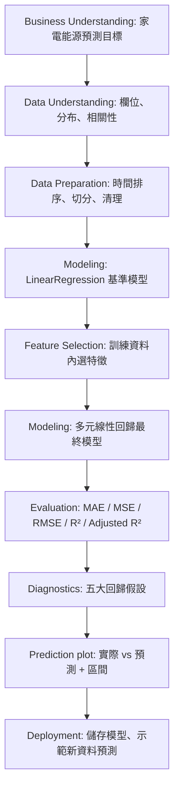

### 4.1 Business Understanding

預測家電的短期耗電（Wh），幫助住宅能源管理；以可解釋的 Linear Regression 為主，而非追求複雜模型最高分。討論輸入資料取得時間：若預測「當下」耗電，可以使用同一時間點環境量測；若預測「下一個 10 分鐘」，需要明確調整 target 時間，以免使用未來才知道的輸入。

### 4.2 Data Understanding

查核維度、型態、空值、重複值、Target 分布、極端值、變數間關係、時間序列趨勢；特別檢查 `rv1` 與 `rv2` 的關係，以及溫度群組的相關性。

### 4.3 Data Preparation

**已實作**按時間排序切分 Train / Validation / Test 為 70% / 15% / 15%（13,814 / 2,960 / 2,961 筆）。不在 Test 上選特徵或調參；標準化若需使用，僅在訓練集上 fit，並包進 Pipeline。可比較隨機切分作為補充實驗，但不要混淆其與時間外推的解釋。

### 4.4 Modeling

- Baseline：完整有效數值特徵的 `LinearRegression`，先處理明顯冗餘的隨機欄位。
- Feature Selection：`SelectKBest(f_regression)`、RFE、Lasso（比較用；主要提交模型仍是 `LinearRegression`）。
- 可比較特徵數：14、20、25；**僅在訓練資料內選特徵與交叉驗證**。如採時間序列交叉驗證，使用 `TimeSeriesSplit`。
- 固定 random seed（凡有隨機演算法時）。

### 4.5 Evaluation

- 指標：MAE、MSE、RMSE、R²、Adjusted R²；於最終鎖定模型後只使用一次 Test 做最後評估。
- 圖表：時間軸上的 Actual vs Predicted、測試集部分樣本的預測區間、Predicted vs Actual、殘差診斷圖。
- 五項檢查（本課作業的操作性定義，後續可依老師指定版本調整）：
  1. 線性關係／模型形式：殘差 vs 擬合值、必要時 Ramsey RESET。
  2. 誤差獨立性／無自相關：Durbin–Watson 與殘差時間序列。
  3. 等變異性：Breusch–Pagan、殘差 vs 擬合值。
  4. 殘差常態性：Q–Q plot、Jarque–Bera（大量樣本下應重視圖形與效果）。
  5. 無嚴重多重共線性：VIF、相關矩陣。
- `LinearRegression` 可在假設不完全成立時執行，但傳統標準誤與預測區間的有效性可能受影響。時間序列的區間不能未經檢查直接視為可靠。

### 4.6 Deployment

使用 `joblib` 保存處理流程和最終模型，提供讀取新一筆合適欄位資料的示範；列出輸入條件、單位、限制及模型適用範圍。

## 5. 推薦報告圖表（規劃，尚未產製）

1. **已產製** Target 分布直方圖。
2. **已產製** 主要特徵與 Target 的相關係數圖、完整矩陣熱圖。
3. **未開始** 特徵選擇方法比較圖（Step 4）。
4. **未開始** Test 時序 Actual vs Predicted，並用圖呈現 **95% prediction interval**（若方法假設不足，需說明）。
5. **未開始** Actual vs Predicted scatter plot。
6. **未開始** Residual vs Fitted、Q–Q、Residual ACF、VIF。
7. **未開始** 模型指標比較表。

## 6. 原始論文與主流方法比較（待深入研究）

原始作者研究過資料篩選、特徵排名及不同模型，作者 GitHub 提供相關實驗檔案。本作業可將 Linear Regression 當作透明的可解釋基線；Ridge、Lasso 可作補充，非線性模型的文獻結果則用來討論性能限制。**不得將不同資料切分下的分數直接當作公平優劣比較。**

來源：
- https://doi.org/10.1016/j.enbuild.2017.01.083
- https://github.com/LuisM78/Appliances-energy-prediction-data

## 7. AI 協助與提交說明

### GPT 輔助內容

本節須在正式報告中明確標示。本次討論涵蓋題目適配性、特徵數計算、CRISP-DM 設計、評估與診斷方法。**另須由使用者將完整實際對話匯出成 PDF**；Markdown 記錄不能取代完整對話匯出。

### NotebookLM 摘要

> 尚未執行 NotebookLM。建議將 UCI 說明、2017 年原始論文及作者 GitHub 的研究材料匯入 NotebookLM，比對研究目的、特徵工程與預測方法；取得其研究結果後再寫至少 100 字摘要，附上來源。不得把 ChatGPT 代寫的文字冒充 NotebookLM 已研究的結論。

### 預定檔案

```text
5115056030_hw2/
├── 5115056030_hw2.py
├── data/
│   └── energydata_complete.csv
├── figures/
├── report.pdf
├── GPT_對話紀錄.pdf
├── README.md                         # 可選
└── models/                           # 視需求建立
```

整個資料夾最後打包為 `5115056030_hw2.zip`。

## 8. 後續階段待完成

- [x] Step 2：使用 CSV 完成欄位、缺失值、重複資料、目標分布、相關性矩陣、自相關、`rv1`/`rv2` 驗證（詳見第 9 節）。
- [x] Step 3：確定 A 方案、依時間 70/15/15 切分、移除重複／隨機欄位、固定 25 特徵候選集合（詳見第 10 節）。
- [ ] Step 4：Feature Selection 與模型訓練。
- [ ] Step 5：模型評估、五項假設、預測區間、圖表。
- [ ] Step 6：使用 NotebookLM 研究，將真實摘要加入報告。
- [ ] Step 7：PDF 報告、對話匯出、README、ZIP。

---

## 9. Step 2 — Data Understanding（真實 CSV 實測，2026-10-15）

### 9.1 資料來源、執行範圍與資料治理

- **實際檔名：** `KAG_energydata_complete.csv`（使用者上傳的完整版本，不是 selected-columns 簡化檔）。
- **來源：** Kaggle https://www.kaggle.com/datasets/loveall/appliances-energy-prediction ；UCI https://archive.ics.uci.edu/dataset/374/appliances+energy+prediction 。
- **分析方法：** 逐列解析原始 CSV、使用 NumPy 計算分位數、樣本標準差、Pearson 相關係數，使用 Matplotlib 製圖。
- **這階段只做探索性資料分析（EDA）**，沒有使用 `LinearRegression` 訓練、沒有劃分 Train/Test、沒有 Feature Selection、沒有計算 R²；不能把全資料相關係數排名當作日後直接選特徵的依據。
- 執行環境輸出：`5115056030_step2_outputs/`；可重現 Python 程式：`5115056030_step2_data_understanding.py`。

### 9.2 資料品質（全部為 CSV 實測結果）

| 檢查項目 | 實際值 | 解釋 |
|---|---:|---|
| 觀測筆數 | **19,735** | 每列為一個 10 分鐘時間點 |
| 原始欄位 | **29** | `date` 1 + Target 1 + 數值輸入 27 |
| 缺失值（所有欄位） | **0** | 不需因缺值填補或刪除 |
| 完全相同的列 | **0** | 無整列重複 |
| 重複日期時間 | **0** | 每筆時間點唯一 |
| 起始時間 | **2016-01-11 17:00:00** | 不可誤寫為全年 |
| 結束時間 | **2016-05-27 18:00:00** | 約 4.5 個月 |
| 相鄰時間間隔 | **10 分鐘** | 全部 19,734 個間隔一致 |
| 常數數值欄位 | **0** | 無全欄恆定不變欄位 |
| 日期排序 | **嚴格遞增** | 可以直接做時間序列切分 |

**解讀：**資料品質良好，主要難題不是空值，而是 Target 偏態、極端高耗電量、時間依賴性及高度相關的輸入變數。

### 9.3 全部 29 欄 — 定義與實測數值範圍

欄位表以 `Appliances` 為預測目標，Pearson r 為每一輸入欄位相對 Target 的全資料*探索性*線性相關係數。溫度單位 °C、相對濕度 %、家電與照明為 Wh。

| 欄位 | 意義／位置 | Min | Max | 與 Target 的 r |
|---|---|---:|---:|---:|
| `date` | 紀錄時間（非數值特徵） | 2016-01-11 | 2016-05-27 | — |
| `Appliances` | 預測目標：家電 10 分鐘耗電量（Wh） | 10.00 | 1080.00 | — |
| `lights` | 照明耗電量（Wh） | 0.00 | 70.00 | +0.197 |
| `T1` | 廚房溫度（°C） | 16.79 | 26.26 | +0.055 |
| `RH_1` | 廚房相對濕度（%） | 27.02 | 63.36 | +0.086 |
| `T2` | 客廳溫度（°C） | 16.10 | 29.86 | +0.120 |
| `RH_2` | 客廳相對濕度（%） | 20.46 | 56.03 | -0.060 |
| `T3` | 洗衣間溫度（°C） | 17.20 | 29.24 | +0.085 |
| `RH_3` | 洗衣間相對濕度（%） | 28.77 | 50.16 | +0.036 |
| `T4` | 辦公室溫度（°C） | 15.10 | 26.20 | +0.040 |
| `RH_4` | 辦公室相對濕度（%） | 27.66 | 51.09 | +0.017 |
| `T5` | 浴室溫度（°C） | 15.33 | 25.80 | +0.020 |
| `RH_5` | 浴室相對濕度（%） | 29.82 | 96.32 | +0.007 |
| `T6` | 屋外北側感測器溫度（°C） | -6.07 | 28.29 | +0.118 |
| `RH_6` | 屋外北側感測器相對濕度（%） | 1.00 | 99.90 | -0.083 |
| `T7` | 熨燙間溫度（°C） | 15.39 | 26.00 | +0.026 |
| `RH_7` | 熨燙間相對濕度（%） | 23.20 | 51.40 | -0.056 |
| `T8` | 青少年房 2 溫度（°C） | 16.31 | 27.23 | +0.040 |
| `RH_8` | 青少年房 2 相對濕度（%） | 29.60 | 58.78 | -0.094 |
| `T9` | 父母房溫度（°C） | 14.89 | 24.50 | +0.010 |
| `RH_9` | 父母房相對濕度（%） | 29.17 | 53.33 | -0.051 |
| `T_out` | 氣象站室外氣溫（°C） | -5.00 | 26.10 | +0.099 |
| `Press_mm_hg` | 氣象站大氣壓力（mmHg） | 729.30 | 772.30 | -0.035 |
| `RH_out` | 氣象站室外相對濕度（%） | 24.00 | 100.00 | -0.152 |
| `Windspeed` | 氣象站風速（m/s） | 0.00 | 14.00 | +0.087 |
| `Visibility` | 氣象站能見度（km） | 1.00 | 66.00 | +0.000 |
| `Tdewpoint` | 氣象站露點溫度（°C） | -6.60 | 15.50 | +0.015 |
| `rv1` | 隨機控制變數 1 | 0.01 | 50.00 | -0.011 |
| `rv2` | 隨機控制變數 2 | 0.01 | 50.00 | -0.011 |

**特徵數嚴格核對：**總欄 29 − `date` 1 − `Appliances`（Target）1 = **27 個數值輸入特徵**，符合課堂限制 `13 < Features < 40`。移除 `rv2` 後為 26 個，移除 `rv1` 和 `rv2` 後為 25 個，均符合限制。`date` 若衍生 `hour`、`weekday` 等欄位，需另外計入實際模型的 Feature Count。

### 9.4 Target `Appliances` — 分布與離群值

| 統計指標 | 依原始 19,735 筆計算 |
|---|---:|
| Min | **10 Wh** |
| Q1（25%） | **50 Wh** |
| Median | **60 Wh** |
| Mean | **97.69 Wh** |
| Q3（75%） | **100 Wh** |
| Max | **1,080 Wh** |
| Standard deviation（樣本標準差） | **102.52 Wh** |
| P95 | **330 Wh** |
| P99 | **576.60 Wh** |
| IQR | **50 Wh** |
| 不同目標數值個數 | **92** |

IQR 判定方法（僅供 EDA）：

```text
IQR = Q3 − Q1 = 100 − 50 = 50 Wh
Lower fence = Q1 − 1.5 × IQR = −25 Wh
Upper fence = Q3 + 1.5 × IQR = 175 Wh
超出界限 = 2,138 / 19,735 = 10.83%
```

- 平均值明顯高於中位數、最大值達 1,080 Wh，觀察到**右偏且長尾**的分布。
- 用 IQR 標記的 2,138 筆全部是高耗電量，不等於資料錯誤：高用電可能反映家電實際運轉；**此階段不刪除任何樣本**。
- 這是具離散刻度的數值型耗電量，仍可作為連續型回歸目標；不等於分類任務。


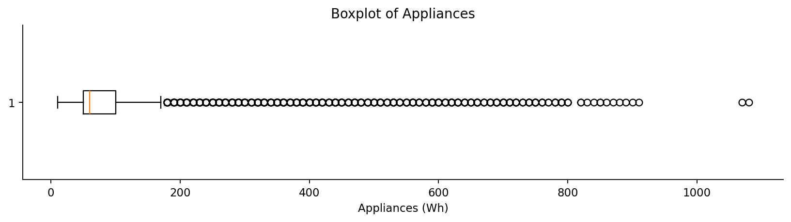

### 9.5 全部特徵與 Target 的 Pearson 相關性

按相關係數絕對值由高至低的前 10 個特徵：

| 順序 | 特徵 | Pearson r | 分析 |
|---:|---|---:|---|
| 1 | `lights` | +0.1973 | 照明耗電量與家電耗電呈正向關係，但仍偏弱 |
| 2 | `RH_out` | -0.1523 | 室外濕度與耗電呈負向關係，但仍偏弱 |
| 3 | `T2` | +0.1201 | 客廳溫度正向相關 |
| 4 | `T6` | +0.1176 | 屋外北側溫度正向相關 |
| 5 | `T_out` | +0.0992 | 氣象站室外溫度正向相關 |
| 6 | `RH_8` | -0.0940 | 青少年房 2 濕度負向相關 |
| 7 | `Windspeed` | +0.0871 | 風速正向相關 |
| 8 | `RH_1` | +0.0860 | 廚房濕度正向相關 |
| 9 | `T3` | +0.0851 | 洗衣間溫度正向相關 |
| 10 | `RH_6` | -0.0832 | 屋外北側濕度負向相關 |

**核心發現：**最強單一特徵 `lights` 與目標的 r 也只有 **+0.1973**，其餘特徵的線性關係更弱。這不表示多元回歸一定無效；因為特徵聯合、交互關係以及實際家電行為未觀測，都可能影響表現。目前尚未訓練模型，**不能宣稱模型 R²**，也不能根據全資料排名直接決定最終特徵。

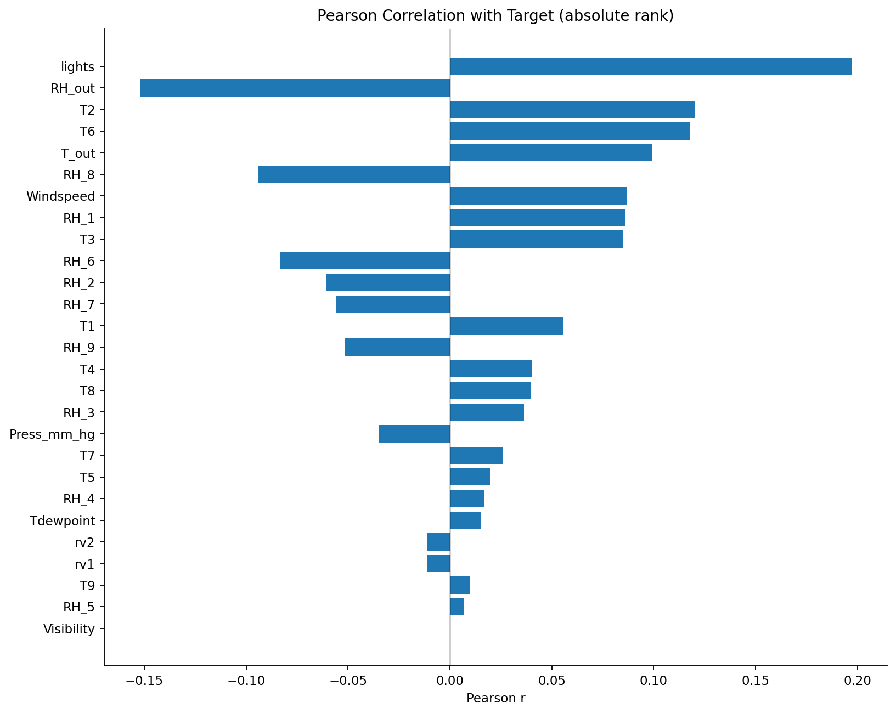

### 9.6 特徵彼此的相關性及共線性

| 變數 A | 變數 B | Pearson r | 問題 |
|---|---|---:|---|
| `rv1` | `rv2` | +1.0000 | 完全重複／完全共線性 |
| `T6` | `T_out` | +0.9748 | 較強的線性共線性風險 |
| `T7` | `T9` | +0.9448 | 較強的線性共線性風險 |
| `T5` | `T9` | +0.9111 | 較強的線性共線性風險 |
| `T3` | `T9` | +0.9013 | 較強的線性共線性風險 |
| `RH_3` | `RH_4` | +0.8990 | 較強的線性共線性風險 |
| `RH_4` | `RH_7` | +0.8943 | 較強的線性共線性風險 |
| `T1` | `T3` | +0.8924 | 較強的線性共線性風險 |
| `T4` | `T9` | +0.8894 | 較強的線性共線性風險 |
| `T3` | `T5` | +0.8882 | 較強的線性共線性風險 |

全部 27 個輸入特徵兩兩比較，`|r| > 0.80` 的組合有 **36 對**，其中 `|r| > 0.90` 有 **5 對**（包含 `rv1`/`rv2`）。這是探索性篩查，不代表 VIF 測試已經完成。

- `rv1`、`rv2` 在 19,735 筆資料中**逐筆完全相同**；因此多元回歸納入兩者會造成設計矩陣秩不足。可以先根據結構性完全重複的事實移除 `rv2`，仍保留 `rv1` 供後續方法辨識無意義特徵。
- `T6` 與 `T_out` 的相關係數為 **+0.9748**，兩種室外氣溫來源幾乎同步，易造成冗餘。
- 多個房間溫度及濕度高度相關，後續應以**訓練資料**檢查 VIF／進行特徵選擇，而非只按單變量 Pearson 排名裁切。


### 9.7 時間分布與時間依賴性

對 `Appliances` 用時間先後排序，計算 lag Pearson 自相關（每筆 10 分鐘）：

| 時間間隔 | 延遲筆數 | Target 的 lag r |
|---|---:|---:|
| 10 分鐘 | 1 | **+0.7532** |
| 1 小時 | 6 | **+0.3237** |
| 2 小時 | 12 | **+0.3109** |
| 24 小時 | 144 | **+0.2167** |

- **這是原始 Target 的時間自相關，不是迴歸模型殘差的 Durbin–Watson 檢驗**；後者要等模型訓練完成才做。
- 10 分鐘 lag r ≈ 0.75，顯示連續時點高度相似，主要實驗不宜任意 shuffle 再隨機切分，以免驗證結果過於樂觀。
- 全資料的逐小時平均耗電中，**18 點約 190.36 Wh**、**03 點約 48.24 Wh**；僅是描述性關聯，不宣稱時段具有因果效應。日平均及時段平均明細另存 CSV。

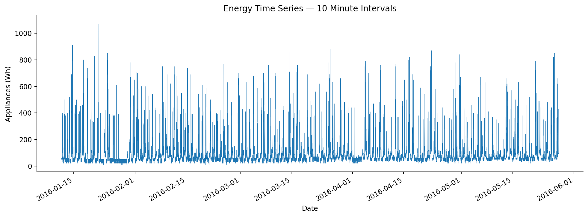

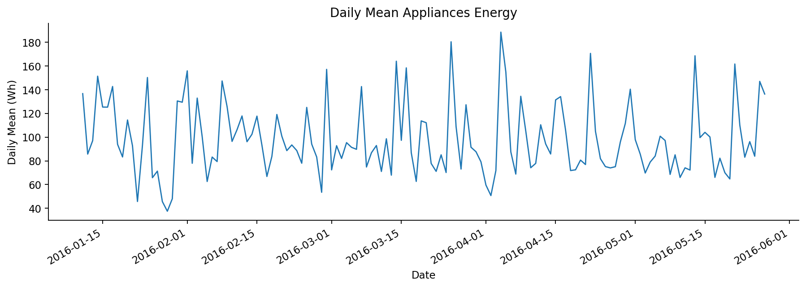

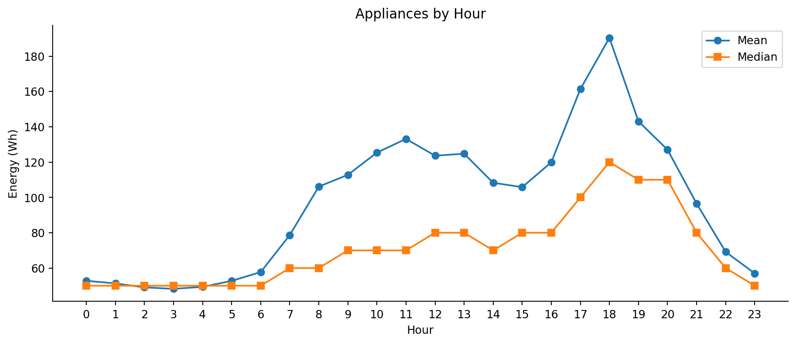

### 9.8 Data Understanding 結論（可用於正式報告）

本研究所採用之 Kaggle Appliances Energy Prediction 資料集共含 19,735 筆資料及 29 個原始欄位，其中排除日期及預測目標 `Appliances` 後，具有 27 個數值輸入特徵，符合本次作業規定的 14–39 個特徵。實際檢查顯示資料無缺失值、無重複時間戳記及重複資料列，每筆資料以 10 分鐘為間隔。預測目標平均耗電量為 97.69 Wh，中位數為 60 Wh，呈現右偏與高耗電長尾現象。Pearson 分析指出，單一輸入特徵與耗電量的線性相關係數普遍偏小，然而不同室內外溫度、濕度感測器之間存在高相關，且 `rv1` 與 `rv2` 完全重複，需留意多重共線性。原始耗電量在相鄰 10 分鐘的相關係數約為 0.753，說明存在明顯時間依賴性。接下來應採用依時間排序的資料切分，在訓練資料內完成特徵選擇，並對線性回歸模型執行評估與殘差診斷。

### 9.9 結果檔案與重現指令

實際產生的檔案：

```text
5115056030_step2_outputs/
├── summary.json
├── column_profile.csv
├── numeric_describe.csv
├── target_correlations.csv
├── pearson_corr_matrix.csv
├── feature_pair_correlations.csv
├── daily_target_summary.csv
├── hourly_target_summary.csv
├── 01_target_histogram.png
├── 02_target_boxplot.png
├── 03_target_over_time.png
├── 04_correlation_heatmap.png
├── 05_target_correlations.png
├── 06_daily_target_mean.png
└── 07_hourly_target_profile.png
```

這裡共有 **8 個結構化統計檔（1 JSON + 7 CSV）與 7 張 PNG 圖**。將原始 CSV、Python 腳本與 MD 放在同一層資料夾，執行：

```bash
pip install numpy matplotlib
python 5115056030_step2_data_understanding.py --csv KAG_energydata_complete.csv --out 5115056030_step2_outputs
```

### 9.10 原先 Step 3 的規劃（現已完成，結果見第 10 節）

1. **已確定**：採 A 方案，同時段電器耗電量估計；不是未來 10 分鐘預測，`lights` 等同時段輸入需在估計時已可取得。
2. 用時間先後切分 Train / Validation / Test（例如 70% / 15% / 15%，之後確認），測試集不得參與特徵選擇。
3. 在模型中移除結構上完全重複的 `rv2`；對其他高相關特徵進行訓練集 VIF 與特徵篩選，不直接憑全資料熱圖裁切。
4. 先擬合簡單 `LinearRegression` baseline，再在訓練資料內比較 14 / 20 / 25 特徵數；以時間序列交叉驗證而非在 Test 上調參。
5. 保留高耗電量真實樣本，先以原始 `Appliances` 為 Target 評估；若比較對數轉換，需將預測還原至 Wh，且僅在訓練/驗證階段決定。
6. 後續才計算 MAE、MSE、RMSE、R²、Adjusted R²，繪製**有合理不確定性方法的預測區間**，並檢驗五大回歸假設（線性、獨立、等變異、常態、共線性）。

> **學術誠信備註：**本節已完成真實 CSV 的探索性統計；尚未完成模型評估、特徵選擇、預測區間、NotebookLM、正式 PDF。報告的「GPT 輔助內容」與「NotebookLM 摘要」仍應獨立標示；ChatGPT 的資料分析不能寫成已由 NotebookLM 查證。


---

## 10. Step 3 — Data Preparation（真實 CSV 實作，2026-10-15）

### 10.1 研究問題與預測時點：採 A 方案

**本研究使用同一個 10 分鐘觀測時段的環境特徵估計該時段 `Appliances`（Wh）。** 這是 **contemporaneous estimation / nowcasting（同期估計）**，並不是未來 10 分鐘的事前預測（forecasting）。

- **輸入 X**：同時間點的 `lights`、9 組溫度、9 組相對濕度、6 欄外部氣象資料（共 25 欄）；`date` 僅做排序，不直接放入線性回歸模型。
- **目標 y**：同列的 `Appliances`，單位 Wh；不做分類、不更改原始單位。
- **使用條件**：如果要在應用中即時估計，當期的照明耗電與環境量測必須已可取得；同期間消耗量的回推估計，不能宣稱具備「尚未發生事件」的預測能力。
- **迴歸公式**：`y_hat = beta_0 + sum(beta_j * x_j)`；Feature Selection 後 p 為 14 或 20，完整基準候選池 p=25。

### 10.2 按時間排序並切分 Train / Validation / Test

本作業採用**時間順序切分（Chronological Split）**，不是隨機打散：

```text
2016-01-11                                                         2016-05-27
|-------------------- TRAIN --------------------|---- VALID ----|---- TEST ----|
                 70% / 13,814 筆                 15% / 2,960   15% / 2,961
                   index [0:13814)             [13814:16774) [16774:19735)
```

精確的切分方法：總筆數 N=19,735；`split1 = int(N * 0.70) = 13,814`，`split2 = int(N * 0.85) = 16,774`。Python slicing 的結尾不含上界。

| 分組 | 切片 index（左含右不含） | 實際筆數 | 起始時間 | 最後時間 |
|---|---|---:|---|---|
| Train | `[0:13814]` | **13,814** | 2016-01-11 17:00 | 2016-04-16 15:10 |
| Validation | `[13814:16774]` | **2,960** | 2016-04-16 15:20 | 2016-05-07 04:30 |
| Test | `[16774:19735]` | **2,961** | 2016-05-07 04:40 | 2016-05-27 18:00 |
| 合計 | — | **19,735** | 無時間交疊、無漏筆 | — |

**檢查通過：**三個集合的時間戳記互不重複、依時序前後分隔、合併後剛好等於 19,735 筆，沒有 missing cells。原始 Target 10 分鐘 lag 自相關約 0.753，因此不用 `train_test_split(..., shuffle=True)` 隨機混合相鄰時點。


### 10.3 逐步處理重複欄位與不需要的欄位

共有 **29 個原始欄位**，但不是全部能當成輸入 X：

| 動作 | 剩餘可用的輸入特徵數 | 原因 |
|---|---:|---|
| 原始 29 欄扣除 `date`（1）及 `Appliances`（1） | **27** | `date` 只保留供排序／畫圖；`Appliances` 是 y，嚴禁當輸入 |
| 排除 `rv2` | **26** | 實測 `rv1` 和 `rv2` 在 19,735 筆**完全相同**；同時放入會產生線性依賴 |
| 排除 `rv1` | **25** | 研究來源明確標示為加入的隨機控制變數，事前排除，不使用 Test 分數決定 |
| 之後使用訓練資料 Feature Selection | **14 或 20** | 以 Train / Validation 比較，確保仍在課堂限制 14–39 之內 |

`date` 並未刪去：在分割 CSV 中仍保留日期、Target、25 個數值特徵，共 **27 欄**，以方便核對與畫殘差時序圖；但是模型的 `X` 只包含明列的 25 個特徵。

**25 個正式候選輸入特徵：**

```text
lights
T1, RH_1, T2, RH_2, T3, RH_3, T4, RH_4, T5, RH_5,
T6, RH_6, T7, RH_7, T8, RH_8, T9, RH_9
T_out, Press_mm_hg, RH_out, Windspeed, Visibility, Tdewpoint
```

計數：`lights` 1 + 室內／室外感測器 T/RH 18 + 外部氣象 6 = **25**。`T6` 和 `T_out` 雖在全資料高度相關，**這階段不根據整份資料的 Pearson 係數刪除任一欄**；在 Step 4 使用 Train 做 VIF / Feature Selection，再以 Validation 比較模型。

**可選的課堂延伸實驗**：保留 `rv1`（但去除 `rv2`）形成 26 特徵的候選池，觀察訓練集的 Feature Selection 是否能去除隨機無關特徵。主實驗仍固定使用 25 個。

### 10.4 真實 Train / Validation / Test 的 Target 分布（切分品質診斷，不作調參）

| 指標 | Training | Validation | Test |
|---|---:|---:|---:|
| 筆數 | 13,814 | 2,960 | 2,961 |
| `Appliances` 平均（Wh） | **98.78** | **93.42** | **96.93** |
| 中位數（Wh） | 60 | 60 | 60 |
| 標準差（Wh） | **106.86** | **92.25** | **90.89** |
| 最小值（Wh） | 10 | 20 | 20 |
| 最大值（Wh） | 1,080 | 870 | 850 |
| 第 95 百分位數（Wh） | 340 | 290 | 280 |
| `lights = 0` 的比例 | **73.28%** | **85.00%** | **88.25%** |
| 缺失值（儲存格） | 0 | 0 | 0 |

這只是描述性切分健檢，**不可利用 Test 的分布調整特徵、挑選模型或門檻**。需注意時間區段存在分布變化：照明耗電為 0 的比例在後期變高，Target 的高耗電尾端也不同，後續在 Validation 評估時須謹慎解讀，不能保證模型在不同季節同樣有效。

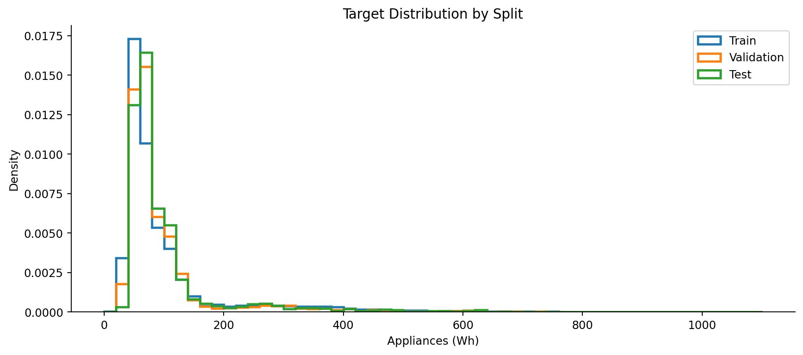

### 10.5 前處理決策（資料洩漏防範）

| 前處理 | 本階段決定 | 理由及後續注意事項 |
|---|---|---|
| Missing Values | **不補值** | 原始全資料實測沒有缺失值 |
| Duplicate rows/time | **不刪除** | 原始資料無重複時間戳記或完全重複列 |
| 完全重複欄位 | **排除 `rv2`** | 根據欄位一致性與研究設計，不用 Target 決定 |
| 隨機控制特徵 | **主實驗排除 `rv1`** | 隨機噪聲變數為原始資料的已知設定 |
| 高耗電極端值 | **全部保留** | IQR 離群值可能是正常家電使用情境，不能直接視為錯誤 |
| Target 轉換 | **不做** | 直接預測 Wh；後續若要試 `log1p`，只能用 Train/Validation 決定 |
| 類別 One-Hot | **不需** | 模型候選特徵全為數值型 |
| 標準化 | **主 LinearRegression 暫不做** | OLS 在數值穩定前提下不依賴尺度；若後續使用 Lasso、Ridge 或具尺度敏感的特徵選擇，應在 Train 內 `fit`，在 Val/Test 僅 `transform` |
| 特徵選擇 | **尚未執行** | Step 4 使用 `Pipeline` 將選擇器和 LinearRegression 包起來，避免 Validation/Test 被用來 fit 選擇器 |
| 交叉驗證 | **尚未執行** | 建議在 Training 使用 `TimeSeriesSplit`（須考慮資料時間順序），再用 Validation 比較方案 |
| Test 使用 | **暫時封存** | 最終模型方案鎖定後，Step 5 才以 Test 算一次正式評估結果 |

> 注意：OLS 可以正常擬合具有高度共線性的資料，但回歸係數可能不穩定。這裡不先用全資料的 Target Pearson 排名選特徵，以免產生看似合理但實際有洩漏的做法。

### 10.6 可重現 Python：實際產出的切分資料

檔案：`5115056030_step3_data_preparation.py`，**本階段僅處理資料，不訓練模型**。使用者可在 Windows CMD、PowerShell、VS Code 終端機執行：

```bash
pip install pandas numpy matplotlib scikit-learn
python 5115056030_step3_data_preparation.py --csv KAG_energydata_complete.csv --out 5115056030_step3_outputs
```

核心切分程式碼（詳見完整 `.py`）：

```python
df = pd.read_csv('KAG_energydata_complete.csv', parse_dates=['date'])
df = df.sort_values('date').reset_index(drop=True)

n = len(df)  # 19735
split1 = int(n * 0.70)  # 13814
split2 = int(n * 0.85)  # 16774

train = df.iloc[:split1].copy()           # 13814 rows
validation = df.iloc[split1:split2].copy() # 2960 rows
test = df.iloc[split2:].copy()            # 2961 rows

# 正式候選 feature_cols 為 25 欄（固定在完整程式 FEATURES 中）
feature_cols = [c for c in df.columns if c not in ('date','Appliances','rv1','rv2')]
assert len(feature_cols) == 25

X_train, y_train = train[feature_cols], train['Appliances']
X_val, y_val = validation[feature_cols], validation['Appliances']
X_test, y_test = test[feature_cols], test['Appliances']
```

**禁止錯誤示範：**先對全資料執行 `SelectKBest.fit_transform(X_all, y_all)`，再做 train/test split。這樣特徵篩選已偷看未來測試目標，後續 R² 不能當公平泛化成績。

### 10.7 輸出成果與驗證

```text
5115056030_step3_outputs/
├── train.csv                          # 13,814 rows; date + Target + 25 features
├── validation.csv                     #  2,960 rows; date + Target + 25 features
├── test.csv                           #  2,961 rows; date + Target + 25 features
├── partition_summary.csv              # 各集合筆數、時間範圍、描述統計
├── manifest.json                      # 檔案 SHA256、25 feature names、排除理由
├── 01_chronological_split.png         # 按時間切分與每日平均耗電
└── 02_target_distribution_by_split.png# 三個集合的 Target 分布比較
```

- 已執行真實 CSV 並輸出完整分割檔，不是只提供預計執行的程式。
- **已驗證 25 個候選 X 特徵**，日期及 Target 沒有混入 X。
- 已檢查 `rv1`、`rv2` 完全相同，資料切分連續、無漏筆或交集。
- 沒有模型訓練、沒有 feature selector fit，也沒有使用 Test 分數挑模型；尚**不能**宣稱已完成 Feature Selection 的作業要求。

### 10.8 Step 4 建模前的決策與下一步

1. 使用 Train（13,814 筆、25 個 X 特徵）建立 `LinearRegression` 完整候選池的基準模型（baseline）。
2. 使用訓練資料比較 `SelectKBest`、RFE 等 Feature Selection，並嘗試 `k=14、20`；`k=25` 作完整基準（不視為縮減特徵）。
3. 特徵選擇與任何需擬合的轉換都置於 `Pipeline`，在 Train 的 `TimeSeriesSplit` 中完成；若用 Validation 比較方法，只能比較，**不能 fit 選擇器**。
4. 確定方法後再決定是否將 Train + Validation 合併重訓（仍不可包含 Test），並鎖定所有超參數與前處理。
5. Test 僅做一次最終評估，接著提供 MAE/MSE/RMSE/R²/Adjusted R²、五大假設診斷與含合理不確定性方法的預測區間。

### 10.9 可放入正式報告的 Data Preparation 段落

本研究採用同一觀測時段之多元線性回歸估計，以住宅室內外溫度、濕度、照明及氣象資料作為輸入，並以家電能源消耗量 `Appliances`（Wh）作為預測目標。原始資料包含 19,735 筆、29 個欄位；排除日期、目標欄後共有 27 個數值輸入特徵。由於 `rv1` 與 `rv2` 逐筆完全相同，為避免線性相依移除 `rv2`；基於資料來源中已知的隨機控制變數身分，同時排除 `rv1`，保留 25 個實際候選特徵。考慮耗電量存在時間依賴性，資料依日期先後以約 70%、15%、15% 劃分 Training（13,814 筆）、Validation（2,960 筆）及 Test（2,961 筆），且時間戳記互不交疊。原始資料無缺失值，無須補值或刪除離群值。此階段不使用 Test 執行特徵選擇及模型調參；後續將在 Training 內比較不同特徵數與選取方法，以 Validation 評估模型選擇，再對 Test 進行單次最終評估。這種流程可降低時間序列隨機切分造成的過度樂觀估計，並保留獨立的泛化能力測試。

---

## 11. 專案進度記錄（原 Step 3 時點；最新狀態請見第 12.12 節）

- [x] Step 1：確認 Kaggle/UCI 來源、特徵數及作業條件。
- [x] Step 2：完整 CSV 欄位、資料品質、Target 分布與 Pearson 相關性實測。
- [x] **Step 3：A 方案同時段估計、70/15/15 時間切分、移除 `rv1`/`rv2`、保留 25 個候選特徵、實際輸出資料。**
- [x] **Step 4：已實際執行** 5 種 Feature Selection、45 筆 Validation 模型比較、各組 VIF、單次正式 Test 與 AR 對照（第 12 節）。
- [ ] Step 5：量化評估、殘差與五項假設、預測圖與區間。
- [ ] Step 6：真實 NotebookLM 研究（至少 100 字摘要）、更優解法比較。
- [ ] Step 7：整理標註「GPT 輔助內容」「NotebookLM 摘要」、匯出 GPT 對話 PDF、最終報告 PDF、打包成學號 ZIP。

---

# 12. Step 4 — Feature Selection & Modeling（實測，2026-10-15）

## 12.1 研究目標、評估邊界與防洩漏協定

**沿用 Step 3 A 方案**：依同一筆紀錄的環境與照明資料估計該 10 分鐘的 `Appliances`（Wh），不預測尚未觀測的未來時段。使用原始 `KAG_energydata_complete.csv`，保留的輸入是 25 個數值特徵（先移除已知隨機對照 `rv1`/`rv2`）。

| 切分 | 筆數 | 用途 | 模型或特徵選擇允許使用嗎？ |
|---|---:|---|---|
| Training | **13,814** | `StandardScaler.fit`、五種 selector `fit`、三種模型 `fit`，SFS 的 TimeSeriesSplit；Permutation 的內部訓練／保留段 | **可以** |
| Validation | **2,960** | 比較預先設定的模型組合，排序採最小 RMSE | **只用於選擇，不參與 scaler/selector/model 的 fit** |
| Test | **2,961** | 最佳 Validation 組合鎖定後，單次評估；另對事前固定的 25 vs 28 Lag 做單次公平對照 | **不參與選擇或調參** |

實際執行：

```python
from sklearn.preprocessing import StandardScaler
scaler = StandardScaler()
X_train_s = scaler.fit_transform(X_train)  # 唯一 fit 的主資料集合
X_val_s   = scaler.transform(X_val)        # 不能 fit
X_test_s  = scaler.transform(X_test)       # 不能 fit
```

**重要區別**：特徵選擇方法的評分可以使用 `y_train`，卻不能使用 `y_val` 或 `y_test` 來訓練 selector。SFS 在 Training 內採 `TimeSeriesSplit(n_splits=3)`，以 `Pipeline(StandardScaler → LinearRegression)` 讓每一折**僅以該折的訓練資料**估計縮放參數；Permutation Importance 則先用 Training 前 80% `fit` 內部 scaler 和模型，再以此 scaler `transform` Training 後 20% 做隨機置換評估（`n_repeats=7`）。這個內部分割與正式 Validation 完全不同。

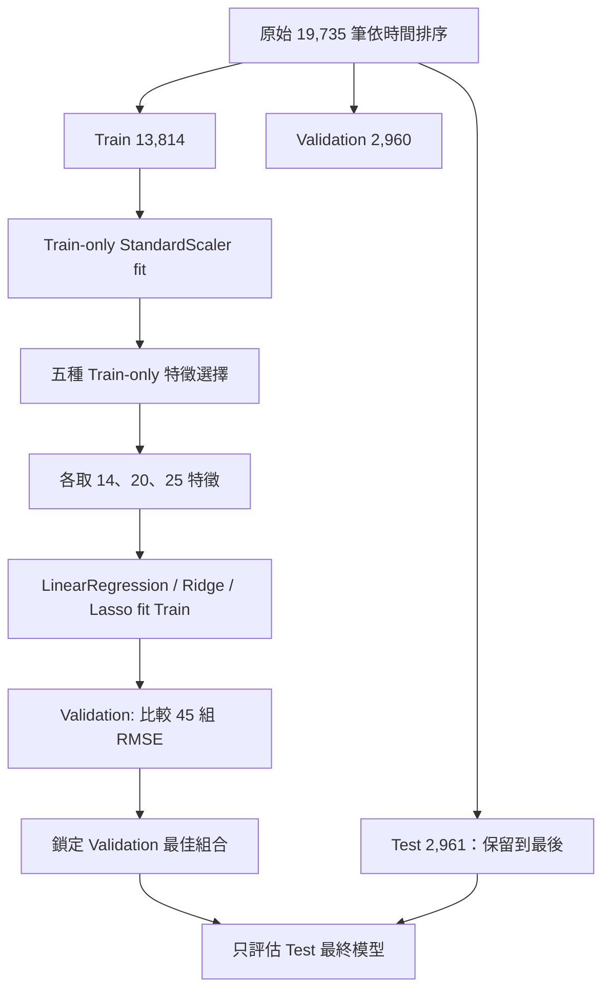

> **舊章節閱讀提示：**前面第 1–3 階段保留當時的分析規劃，部分以「未進行 Step 4」為過去狀態；第 12 節是最新的實際結果與修訂方法。

> `k=25` 時五種選擇器都保留完全相同的全部欄位，故 45 列指標中有等價重複：**有 45 筆設定紀錄，但只對應 33 個不重複的（特徵子集、模型）組合。** 不應把 `k=25` 的五個相同數字誤解為五個獨立的選取成果。

## 12.2 五種 Feature Selection 的具體實作

| 方法 | 使用資料 | 操作細節 | 注意事項 |
|---|---|---|---|
| **SelectKBest（`f_regression`）** | Train | 先以 F 檢定分數排序，擷取 top-k | 只看各特徵與 y 的單變量線性關係，可能保留彼此冗餘的欄位 |
| **RFE（Recursive Feature Elimination）** | Train | 每輪擬合 `LinearRegression`，反覆移除低權重特徵，直到 k | 共線性可能讓係數排名不穩定 |
| **SFS（Sequential Feature Selection）** | Train | `k=14` forward、`k=20` backward；3-fold `TimeSeriesSplit`，折內各自 fit scaler，最小化 CV RMSE | 特徵集合是貪婪搜尋的結果，不保證全域最優 |
| **Lasso 係數排序** | Train | 標準化後 `Lasso(alpha=0.1)` 依 `abs(coef_)` 選出前 k | 為取得**精確 k 個**特徵採係數排序；**非單純「保留所有非零係數」** |
| **Permutation Importance** | Train 內部 | 前 80% fit 內部 scaler＋建線性模型；後 20% 僅 transform 後計算打散特徵的 RMSE 增量，重複 7 次，再取前 k | 在相關特徵間重要性容易被稀釋；不適用因果推論 |

本次 Lasso 特徵排序模型的非零係數有 **24** 個，故 14、20 個特徵均可從非零係數中選出；不會為了湊數量強迫納入零係數特徵。

**模型條件固定**：`LinearRegression()`、`Ridge(alpha=10.0)`、`Lasso(alpha=0.1, max_iter=20000)`。Lasso / Ridge 在標準化資料上比較；本次**沒有**對 `alpha` 進行大量搜尋或以 Test 調參，因此不能宣稱它們代表最佳可能正則化強度。若之後想改動 alpha，應另開以 Training TimeSeriesSplit 完成的預先規劃實驗，不得利用 Test 結果回頭改本次選擇。

## 12.3 十五組特徵子集清單（每組 14／20／25）

這裡的次序遵守 Step 3 `FEATURES` 原始欄位次序，不是特徵重要性名次；重要性原始分數另存 `selector_train_only_details.json`。

| Feature Selection | k | Train 上選出的特徵 |
|---|---:|---|
| SelectKBest | 14 | `lights`, `T1`, `RH_1`, `T2`, `T3`, `T4`, `T6`, `RH_6`, `RH_7`, `T8`, `RH_8`, `RH_9`, `T_out`, `RH_out` |
| SelectKBest | 20 | `lights`, `T1`, `RH_1`, `T2`, `RH_2`, `T3`, `RH_3`, `T4`, `T5`, `T6`, `RH_6`, `T7`, `RH_7`, `T8`, `RH_8`, `RH_9`, `T_out`, `Press_mm_hg`, `RH_out`, `Windspeed` |
| SelectKBest | 25 | `lights`, `T1`, `RH_1`, `T2`, `RH_2`, `T3`, `RH_3`, `T4`, `RH_4`, `T5`, `RH_5`, `T6`, `RH_6`, `T7`, `RH_7`, `T8`, `RH_8`, `T9`, `RH_9`, `T_out`, `Press_mm_hg`, `RH_out`, `Windspeed`, `Visibility`, `Tdewpoint` |
| RFE | 14 | `lights`, `T1`, `RH_1`, `T2`, `RH_2`, `T3`, `RH_3`, `T6`, `T8`, `RH_8`, `T9`, `T_out`, `RH_out`, `Tdewpoint` |
| RFE | 20 | `lights`, `T1`, `RH_1`, `T2`, `RH_2`, `T3`, `RH_3`, `T4`, `RH_4`, `T6`, `RH_6`, `T8`, `RH_8`, `T9`, `RH_9`, `T_out`, `Press_mm_hg`, `RH_out`, `Windspeed`, `Tdewpoint` |
| RFE | 25 | `lights`, `T1`, `RH_1`, `T2`, `RH_2`, `T3`, `RH_3`, `T4`, `RH_4`, `T5`, `RH_5`, `T6`, `RH_6`, `T7`, `RH_7`, `T8`, `RH_8`, `T9`, `RH_9`, `T_out`, `Press_mm_hg`, `RH_out`, `Windspeed`, `Visibility`, `Tdewpoint` |
| SFS | 14 | `RH_1`, `RH_3`, `RH_4`, `T6`, `RH_6`, `RH_7`, `RH_8`, `RH_9`, `T_out`, `Press_mm_hg`, `RH_out`, `Windspeed`, `Visibility`, `Tdewpoint` |
| SFS | 20 | `lights`, `T1`, `RH_1`, `T3`, `RH_3`, `T4`, `RH_4`, `T5`, `RH_5`, `T6`, `T7`, `RH_7`, `T8`, `RH_8`, `RH_9`, `T_out`, `RH_out`, `Windspeed`, `Visibility`, `Tdewpoint` |
| SFS | 25 | `lights`, `T1`, `RH_1`, `T2`, `RH_2`, `T3`, `RH_3`, `T4`, `RH_4`, `T5`, `RH_5`, `T6`, `RH_6`, `T7`, `RH_7`, `T8`, `RH_8`, `T9`, `RH_9`, `T_out`, `Press_mm_hg`, `RH_out`, `Windspeed`, `Visibility`, `Tdewpoint` |
| Lasso | 14 | `lights`, `T1`, `RH_1`, `T2`, `RH_2`, `T3`, `RH_3`, `RH_4`, `T6`, `T8`, `RH_8`, `T9`, `RH_9`, `T_out` |
| Lasso | 20 | `lights`, `T1`, `RH_1`, `T2`, `RH_2`, `T3`, `RH_3`, `T4`, `RH_4`, `T6`, `RH_6`, `T8`, `RH_8`, `T9`, `RH_9`, `T_out`, `Press_mm_hg`, `RH_out`, `Windspeed`, `Visibility` |
| Lasso | 25 | `lights`, `T1`, `RH_1`, `T2`, `RH_2`, `T3`, `RH_3`, `T4`, `RH_4`, `T5`, `RH_5`, `T6`, `RH_6`, `T7`, `RH_7`, `T8`, `RH_8`, `T9`, `RH_9`, `T_out`, `Press_mm_hg`, `RH_out`, `Windspeed`, `Visibility`, `Tdewpoint` |
| PermutationImportance | 14 | `lights`, `RH_1`, `T2`, `RH_2`, `T3`, `RH_3`, `T6`, `RH_6`, `T7`, `T8`, `RH_8`, `T_out`, `RH_out`, `Tdewpoint` |
| PermutationImportance | 20 | `lights`, `T1`, `RH_1`, `T2`, `RH_2`, `T3`, `RH_3`, `T4`, `T5`, `T6`, `RH_6`, `T7`, `RH_7`, `T8`, `RH_8`, `T_out`, `RH_out`, `Windspeed`, `Visibility`, `Tdewpoint` |
| PermutationImportance | 25 | `lights`, `T1`, `RH_1`, `T2`, `RH_2`, `T3`, `RH_3`, `T4`, `RH_4`, `T5`, `RH_5`, `T6`, `RH_6`, `T7`, `RH_7`, `T8`, `RH_8`, `T9`, `RH_9`, `T_out`, `Press_mm_hg`, `RH_out`, `Windspeed`, `Visibility`, `Tdewpoint` |

## 12.4 各組 VIF（只在 Training 計算）

VIF（Variance Inflation Factor）以訓練資料其他入選特徵迴歸當前特徵，計算：

\[VIF_j=\frac{1}{1-R_j^2}\]

其中 `R_j²` 是利用其餘入選 X 特徵預測 `X_j` 的輔助回歸決定係數，**不是預測 Appliances 的 R²**。VIF 不需要 Target `y`。常用經驗值：VIF > 5 提醒注意、>10 表示高共線性風險；並非機械式剔除標準。

### 12.4.1 VIF 摘要：每種方法 × 每個 k

| Selector | k | 最大 VIF | 中位 VIF | VIF > 5 欄數 | VIF > 10 欄數 | 最大 VIF 欄位 |
|---|---:|---:|---:|---:|---:|---|
| SelectKBest | 14 | 26.36 | 5.51 | 9 | 3 | `T_out` |
| SelectKBest | 20 | 27.41 | 7.50 | 15 | 7 | `T_out` |
| SelectKBest | 25 | 404.83 | 9.99 | 19 | 12 | `T_out` |
| RFE | 14 | 364.74 | 12.72 | 11 | 9 | `T_out` |
| RFE | 20 | 384.16 | 11.52 | 16 | 11 | `T_out` |
| RFE | 25 | 404.83 | 9.99 | 19 | 12 | `T_out` |
| SFS | 14 | 366.27 | 7.74 | 10 | 6 | `T_out` |
| SFS | 20 | 383.22 | 6.59 | 15 | 6 | `T_out` |
| SFS | 25 | 404.83 | 9.99 | 19 | 12 | `T_out` |
| Lasso | 14 | 23.63 | 11.84 | 12 | 8 | `T6` |
| Lasso | 20 | 27.57 | 7.49 | 14 | 9 | `T_out` |
| Lasso | 25 | 404.83 | 9.99 | 19 | 12 | `T_out` |
| PermutationImportance | 14 | 382.45 | 8.07 | 11 | 5 | `T_out` |
| PermutationImportance | 20 | 391.45 | 8.57 | 16 | 9 | `T_out` |
| PermutationImportance | 25 | 404.83 | 9.99 | 19 | 12 | `T_out` |

**重點發現：**25 個原始候選特徵模型的最大 VIF 約 **404.83**，主要來自 `T_out`；Validation 最佳模型（Permutation Importance, k=14）最大 VIF 仍約 **382.45**，說明**Validation RMSE 最佳 ≠ 共線性最少**。這是本作業對「預測表現 vs 係數穩定性」的研究重點。未建議只因 VIF 高而把所有相關欄位刪除，否則可能犧牲預測能力。

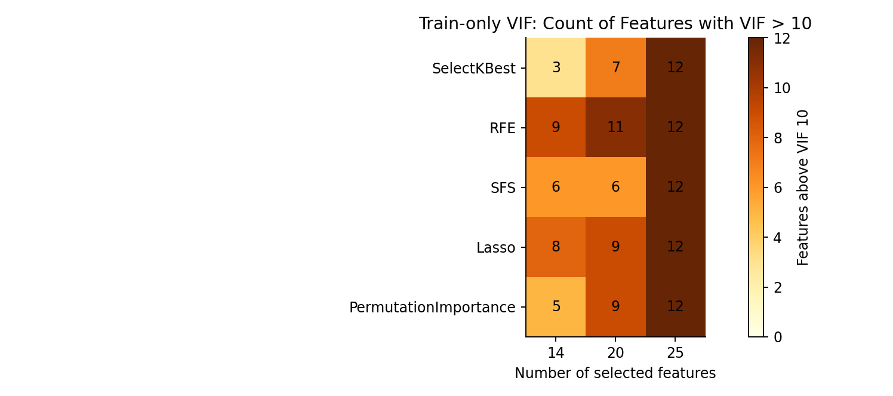

### 12.4.2 每個入選特徵的 VIF 詳表（15 組）

完整數值亦另存為 `vif_details.csv`，若後續要做 VIF 門檻篩選，**必須只從 Training** 計算。以下保留每一組每個被選中欄位的具體 VIF。

**SelectKBest — 14 Features**

| 特徵 | VIF | 特徵 | VIF |
|---|---:|---|---:|
| `T_out` | 26.36 | `T6` | 25.77 |
| `T1` | 10.48 | `RH_8` | 7.42 |
| `RH_7` | 7.41 | `RH_6` | 6.45 |
| `T2` | 5.67 | `T3` | 5.35 |
| `RH_9` | 5.09 | `RH_1` | 3.77 |
| `T8` | 3.75 | `RH_out` | 3.48 |
| `T4` | 2.93 | `lights` | 1.18 |

**SelectKBest — 20 Features**

| 特徵 | VIF | 特徵 | VIF |
|---|---:|---|---:|
| `T_out` | 27.41 | `T6` | 26.89 |
| `T2` | 16.38 | `RH_2` | 13.99 |
| `T1` | 13.43 | `RH_1` | 12.48 |
| `RH_3` | 11.66 | `RH_8` | 9.81 |
| `RH_7` | 9.26 | `T7` | 7.56 |
| `RH_6` | 7.45 | `RH_9` | 6.52 |
| `T8` | 6.15 | `T3` | 5.94 |
| `T5` | 5.17 | `RH_out` | 4.49 |
| `T4` | 3.36 | `Windspeed` | 1.75 |
| `Press_mm_hg` | 1.41 | `lights` | 1.24 |

**SelectKBest — 25 Features**

| 特徵 | VIF | 特徵 | VIF |
|---|---:|---|---:|
| `T_out` | 404.83 | `Tdewpoint` | 312.10 |
| `RH_out` | 117.30 | `T6` | 27.33 |
| `T2` | 18.34 | `RH_4` | 16.76 |
| `RH_2` | 15.87 | `T9` | 15.21 |
| `T1` | 14.38 | `RH_3` | 12.69 |
| `RH_1` | 12.62 | `RH_7` | 10.44 |
| `RH_8` | 9.99 | `T7` | 9.95 |
| `RH_6` | 7.95 | `RH_9` | 6.88 |
| `T3` | 6.83 | `T8` | 6.43 |
| `T5` | 6.21 | `T4` | 4.13 |
| `Windspeed` | 1.82 | `Press_mm_hg` | 1.49 |
| `RH_5` | 1.41 | `lights` | 1.33 |
| `Visibility` | 1.06 | — | — |

**RFE — 14 Features**

| 特徵 | VIF | 特徵 | VIF |
|---|---:|---|---:|
| `T_out` | 364.74 | `Tdewpoint` | 276.52 |
| `RH_out` | 107.30 | `T6` | 23.96 |
| `T2` | 15.23 | `T1` | 13.50 |
| `RH_2` | 13.25 | `RH_1` | 12.19 |
| `RH_3` | 10.07 | `T9` | 8.04 |
| `T3` | 6.42 | `RH_8` | 4.97 |
| `T8` | 4.70 | `lights` | 1.17 |

**RFE — 20 Features**

| 特徵 | VIF | 特徵 | VIF |
|---|---:|---|---:|
| `T_out` | 384.16 | `Tdewpoint` | 296.83 |
| `RH_out` | 113.59 | `T6` | 26.45 |
| `T2` | 17.78 | `RH_2` | 15.28 |
| `RH_4` | 15.19 | `T1` | 14.14 |
| `RH_3` | 12.50 | `RH_1` | 12.35 |
| `T9` | 10.68 | `RH_6` | 7.78 |
| `RH_8` | 7.36 | `T3` | 6.58 |
| `RH_9` | 6.36 | `T8` | 5.11 |
| `T4` | 4.01 | `Windspeed` | 1.78 |
| `Press_mm_hg` | 1.42 | `lights` | 1.32 |

**RFE — 25 Features**

| 特徵 | VIF | 特徵 | VIF |
|---|---:|---|---:|
| `T_out` | 404.83 | `Tdewpoint` | 312.10 |
| `RH_out` | 117.30 | `T6` | 27.33 |
| `T2` | 18.34 | `RH_4` | 16.76 |
| `RH_2` | 15.87 | `T9` | 15.21 |
| `T1` | 14.38 | `RH_3` | 12.69 |
| `RH_1` | 12.62 | `RH_7` | 10.44 |
| `RH_8` | 9.99 | `T7` | 9.95 |
| `RH_6` | 7.95 | `RH_9` | 6.88 |
| `T3` | 6.83 | `T8` | 6.43 |
| `T5` | 6.21 | `T4` | 4.13 |
| `Windspeed` | 1.82 | `Press_mm_hg` | 1.49 |
| `RH_5` | 1.41 | `lights` | 1.33 |
| `Visibility` | 1.06 | — | — |

**SFS — 14 Features**

| 特徵 | VIF | 特徵 | VIF |
|---|---:|---|---:|
| `T_out` | 366.27 | `Tdewpoint` | 275.01 |
| `RH_out` | 110.24 | `T6` | 22.73 |
| `RH_4` | 12.43 | `RH_3` | 10.69 |
| `RH_7` | 8.00 | `RH_8` | 7.48 |
| `RH_1` | 5.73 | `RH_9` | 5.54 |
| `RH_6` | 4.96 | `Windspeed` | 1.68 |
| `Press_mm_hg` | 1.23 | `Visibility` | 1.04 |

**SFS — 20 Features**

| 特徵 | VIF | 特徵 | VIF |
|---|---:|---|---:|
| `T_out` | 383.22 | `Tdewpoint` | 284.26 |
| `RH_out` | 112.66 | `T6` | 22.11 |
| `RH_4` | 14.80 | `RH_3` | 11.48 |
| `RH_8` | 9.86 | `RH_7` | 9.82 |
| `T7` | 7.42 | `RH_1` | 6.74 |
| `RH_9` | 6.44 | `T8` | 6.01 |
| `T1` | 5.80 | `T3` | 5.49 |
| `T5` | 5.14 | `T4` | 3.76 |
| `Windspeed` | 1.63 | `RH_5` | 1.40 |
| `lights` | 1.27 | `Visibility` | 1.05 |

**SFS — 25 Features**

| 特徵 | VIF | 特徵 | VIF |
|---|---:|---|---:|
| `T_out` | 404.83 | `Tdewpoint` | 312.10 |
| `RH_out` | 117.30 | `T6` | 27.33 |
| `T2` | 18.34 | `RH_4` | 16.76 |
| `RH_2` | 15.87 | `T9` | 15.21 |
| `T1` | 14.38 | `RH_3` | 12.69 |
| `RH_1` | 12.62 | `RH_7` | 10.44 |
| `RH_8` | 9.99 | `T7` | 9.95 |
| `RH_6` | 7.95 | `RH_9` | 6.88 |
| `T3` | 6.83 | `T8` | 6.43 |
| `T5` | 6.21 | `T4` | 4.13 |
| `Windspeed` | 1.82 | `Press_mm_hg` | 1.49 |
| `RH_5` | 1.41 | `lights` | 1.33 |
| `Visibility` | 1.06 | — | — |

**Lasso — 14 Features**

| 特徵 | VIF | 特徵 | VIF |
|---|---:|---|---:|
| `T6` | 23.63 | `T_out` | 23.30 |
| `T2` | 16.76 | `RH_2` | 13.73 |
| `T1` | 13.48 | `RH_4` | 12.29 |
| `RH_1` | 12.19 | `RH_3` | 11.49 |
| `T9` | 8.76 | `T3` | 6.43 |
| `RH_8` | 6.02 | `RH_9` | 5.86 |
| `T8` | 4.86 | `lights` | 1.18 |

**Lasso — 20 Features**

| 特徵 | VIF | 特徵 | VIF |
|---|---:|---|---:|
| `T_out` | 27.57 | `T6` | 26.43 |
| `T2` | 17.79 | `RH_4` | 15.23 |
| `RH_2` | 15.09 | `T1` | 14.12 |
| `RH_3` | 12.47 | `RH_1` | 12.35 |
| `T9` | 10.63 | `RH_6` | 7.61 |
| `RH_8` | 7.38 | `T3` | 6.58 |
| `RH_9` | 6.24 | `T8` | 5.09 |
| `RH_out` | 4.46 | `T4` | 4.01 |
| `Windspeed` | 1.74 | `Press_mm_hg` | 1.41 |
| `lights` | 1.32 | `Visibility` | 1.05 |

**Lasso — 25 Features**

| 特徵 | VIF | 特徵 | VIF |
|---|---:|---|---:|
| `T_out` | 404.83 | `Tdewpoint` | 312.10 |
| `RH_out` | 117.30 | `T6` | 27.33 |
| `T2` | 18.34 | `RH_4` | 16.76 |
| `RH_2` | 15.87 | `T9` | 15.21 |
| `T1` | 14.38 | `RH_3` | 12.69 |
| `RH_1` | 12.62 | `RH_7` | 10.44 |
| `RH_8` | 9.99 | `T7` | 9.95 |
| `RH_6` | 7.95 | `RH_9` | 6.88 |
| `T3` | 6.83 | `T8` | 6.43 |
| `T5` | 6.21 | `T4` | 4.13 |
| `Windspeed` | 1.82 | `Press_mm_hg` | 1.49 |
| `RH_5` | 1.41 | `lights` | 1.33 |
| `Visibility` | 1.06 | — | — |

**PermutationImportance — 14 Features**

| 特徵 | VIF | 特徵 | VIF |
|---|---:|---|---:|
| `T_out` | 382.45 | `Tdewpoint` | 292.19 |
| `RH_out` | 110.10 | `T6` | 25.12 |
| `RH_3` | 10.03 | `RH_2` | 9.90 |
| `RH_1` | 9.10 | `RH_6` | 7.05 |
| `T2` | 5.54 | `T7` | 5.45 |
| `RH_8` | 5.14 | `T8` | 4.37 |
| `T3` | 4.31 | `lights` | 1.13 |

**PermutationImportance — 20 Features**

| 特徵 | VIF | 特徵 | VIF |
|---|---:|---|---:|
| `T_out` | 391.45 | `Tdewpoint` | 301.58 |
| `RH_out` | 114.64 | `T6` | 26.53 |
| `T2` | 16.35 | `RH_2` | 14.16 |
| `T1` | 13.31 | `RH_1` | 12.34 |
| `RH_3` | 10.76 | `RH_7` | 9.20 |
| `RH_8` | 7.95 | `RH_6` | 7.48 |
| `T7` | 7.00 | `T3` | 5.66 |
| `T8` | 5.65 | `T5` | 5.04 |
| `T4` | 3.34 | `Windspeed` | 1.65 |
| `lights` | 1.23 | `Visibility` | 1.05 |

**PermutationImportance — 25 Features**

| 特徵 | VIF | 特徵 | VIF |
|---|---:|---|---:|
| `T_out` | 404.83 | `Tdewpoint` | 312.10 |
| `RH_out` | 117.30 | `T6` | 27.33 |
| `T2` | 18.34 | `RH_4` | 16.76 |
| `RH_2` | 15.87 | `T9` | 15.21 |
| `T1` | 14.38 | `RH_3` | 12.69 |
| `RH_1` | 12.62 | `RH_7` | 10.44 |
| `RH_8` | 9.99 | `T7` | 9.95 |
| `RH_6` | 7.95 | `RH_9` | 6.88 |
| `T3` | 6.83 | `T8` | 6.43 |
| `T5` | 6.21 | `T4` | 4.13 |
| `Windspeed` | 1.82 | `Press_mm_hg` | 1.49 |
| `RH_5` | 1.41 | `lights` | 1.33 |
| `Visibility` | 1.06 | — | — |

## 12.5 45 組 Validation 評估：完整比較表

**僅在 Validation 上計分**，未以 Test 參與排序；表內依 RMSE 由小到大排列。指標在原始目標尺度 `Wh` 上計算：

- `MAE = mean(|y−ŷ|)`（Wh）
- `MSE = mean((y−ŷ)²)`（Wh²）
- `RMSE = sqrt(MSE)`（Wh）
- `R² = 1 − SSE/SST`
- `Adjusted R² = 1 − (1−R²)(n−1)/(n−p−1)`，p=選取的輸入特徵數、n=2,960。

| 排名 | Selector | k | 回歸模型 | MAE (Wh) | MSE (Wh²) | RMSE (Wh) | R² | Adj. R² |
|---:|---|---:|---|---:|---:|---:|---:|---:|
| 1 | PermutationImportance | 14 | LinearRegression | 50.88 | 7175.31 | 84.71 | 0.1566 | 0.1526 |
| 2 | PermutationImportance | 14 | Ridge | 51.34 | 7209.53 | 84.91 | 0.1526 | 0.1486 |
| 3 | SFS | 20 | Lasso | 46.50 | 7251.55 | 85.16 | 0.1477 | 0.1419 |
| 4 | SFS | 20 | Ridge | 47.02 | 7258.91 | 85.20 | 0.1468 | 0.1410 |
| 5 | SFS | 20 | LinearRegression | 47.30 | 7266.61 | 85.24 | 0.1459 | 0.1401 |
| 6 | PermutationImportance | 20 | LinearRegression | 50.51 | 7266.62 | 85.24 | 0.1459 | 0.1401 |
| 7 | PermutationImportance | 20 | Ridge | 50.87 | 7287.84 | 85.37 | 0.1434 | 0.1376 |
| 8 | PermutationImportance | 14 | Lasso | 52.25 | 7288.38 | 85.37 | 0.1434 | 0.1393 |
| 9 | PermutationImportance | 20 | Lasso | 51.48 | 7343.81 | 85.70 | 0.1368 | 0.1310 |
| 10 | RFE | 14 | Ridge | 53.40 | 7429.29 | 86.19 | 0.1268 | 0.1226 |
| 11 | RFE | 14 | LinearRegression | 52.85 | 7431.90 | 86.21 | 0.1265 | 0.1223 |
| 12 | RFE | 14 | Lasso | 54.70 | 7517.07 | 86.70 | 0.1165 | 0.1123 |
| 13 | SelectKBest | 20 | LinearRegression | 54.28 | 7520.80 | 86.72 | 0.1160 | 0.1100 |
| 14 | SelectKBest | 20 | Ridge | 54.24 | 7524.58 | 86.74 | 0.1156 | 0.1096 |
| 15 | SelectKBest | 20 | Lasso | 54.29 | 7539.50 | 86.83 | 0.1138 | 0.1078 |
| 16 | Lasso | 25 | LinearRegression | 54.58 | 7567.42 | 86.99 | 0.1106 | 0.1030 |
| 17 | PermutationImportance | 25 | LinearRegression | 54.58 | 7567.42 | 86.99 | 0.1106 | 0.1030 |
| 18 | RFE | 25 | LinearRegression | 54.58 | 7567.42 | 86.99 | 0.1106 | 0.1030 |
| 19 | SFS | 25 | LinearRegression | 54.58 | 7567.42 | 86.99 | 0.1106 | 0.1030 |
| 20 | SelectKBest | 25 | LinearRegression | 54.58 | 7567.42 | 86.99 | 0.1106 | 0.1030 |
| 21 | RFE | 20 | LinearRegression | 54.94 | 7585.85 | 87.10 | 0.1084 | 0.1023 |
| 22 | Lasso | 25 | Ridge | 55.07 | 7600.75 | 87.18 | 0.1066 | 0.0990 |
| 23 | PermutationImportance | 25 | Ridge | 55.07 | 7600.75 | 87.18 | 0.1066 | 0.0990 |
| 24 | RFE | 25 | Ridge | 55.07 | 7600.75 | 87.18 | 0.1066 | 0.0990 |
| 25 | SFS | 25 | Ridge | 55.07 | 7600.75 | 87.18 | 0.1066 | 0.0990 |
| 26 | SelectKBest | 25 | Ridge | 55.07 | 7600.75 | 87.18 | 0.1066 | 0.0990 |
| 27 | RFE | 20 | Ridge | 55.43 | 7624.12 | 87.32 | 0.1039 | 0.0978 |
| 28 | Lasso | 14 | LinearRegression | 56.50 | 7653.09 | 87.48 | 0.1005 | 0.0962 |
| 29 | Lasso | 25 | Lasso | 55.58 | 7658.63 | 87.51 | 0.0998 | 0.0922 |
| 30 | PermutationImportance | 25 | Lasso | 55.58 | 7658.63 | 87.51 | 0.0998 | 0.0922 |
| 31 | RFE | 25 | Lasso | 55.58 | 7658.63 | 87.51 | 0.0998 | 0.0922 |
| 32 | SFS | 25 | Lasso | 55.58 | 7658.63 | 87.51 | 0.0998 | 0.0922 |
| 33 | SelectKBest | 25 | Lasso | 55.58 | 7658.63 | 87.51 | 0.0998 | 0.0922 |
| 34 | Lasso | 14 | Ridge | 56.55 | 7660.95 | 87.53 | 0.0996 | 0.0953 |
| 35 | Lasso | 20 | LinearRegression | 56.00 | 7678.45 | 87.63 | 0.0975 | 0.0914 |
| 36 | Lasso | 20 | Ridge | 55.99 | 7681.78 | 87.65 | 0.0971 | 0.0910 |
| 37 | Lasso | 14 | Lasso | 56.77 | 7685.16 | 87.67 | 0.0967 | 0.0924 |
| 38 | RFE | 20 | Lasso | 56.04 | 7688.11 | 87.68 | 0.0964 | 0.0902 |
| 39 | Lasso | 20 | Lasso | 56.04 | 7690.69 | 87.70 | 0.0961 | 0.0899 |
| 40 | SFS | 14 | Lasso | 47.29 | 7787.61 | 88.25 | 0.0847 | 0.0803 |
| 41 | SFS | 14 | Ridge | 47.72 | 7803.51 | 88.34 | 0.0828 | 0.0784 |
| 42 | SFS | 14 | LinearRegression | 47.70 | 7808.80 | 88.37 | 0.0822 | 0.0778 |
| 43 | SelectKBest | 14 | Lasso | 53.34 | 7903.28 | 88.90 | 0.0711 | 0.0667 |
| 44 | SelectKBest | 14 | Ridge | 53.70 | 7936.77 | 89.09 | 0.0671 | 0.0627 |
| 45 | SelectKBest | 14 | LinearRegression | 53.80 | 7946.90 | 89.15 | 0.0660 | 0.0615 |


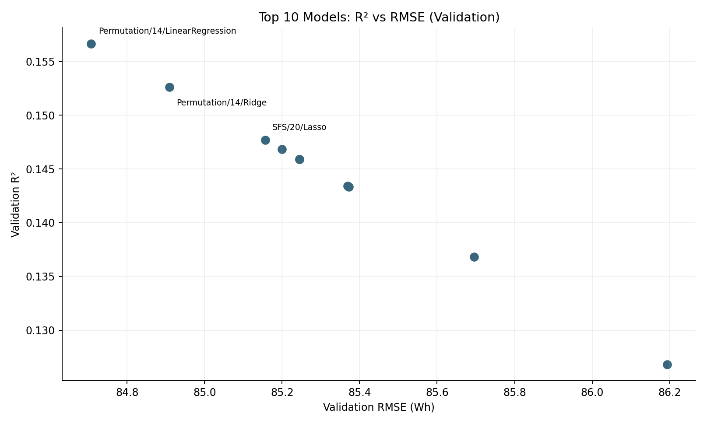

## 12.6 Validation 最佳組合與一次性 Test 結果

本次模型選擇準則固定為 **Validation RMSE 最低**，在 45 條記錄中鎖定的方案如下：

- **最佳選擇器**：`PermutationImportance`
- **特徵數**：14
- **迴歸模型**：`LinearRegression`
- **精確特徵清單**：`lights`, `RH_1`, `T2`, `RH_2`, `T3`, `RH_3`, `T6`, `RH_6`, `T7`, `T8`, `RH_8`, `T_out`, `RH_out`, `Tdewpoint`

| 指標 | Validation（選模型） | Test（只在鎖定後評估） |
|---|---:|---:|
| N (筆) | 2960 | 2961 |
| p (特徵) | 14 | 14 |
| MAE (Wh) | 50.8772 | 60.1674 |
| MSE (Wh²) | 7175.3141 | 7955.9021 |
| RMSE (Wh) | 84.7072 | 89.1959 |
| R2 () | 0.1566 | 0.0366 |
| Adjusted_R2 () | 0.1526 | 0.0320 |

這個模型雖在 Validation 的 RMSE 最低，但 Test R² 明顯下降。**這是泛化能力變化，不代表被允許回頭用 Test 改選另一組。** 模型的 VIF 偏高，解釋單一迴歸係數時必須謹慎。

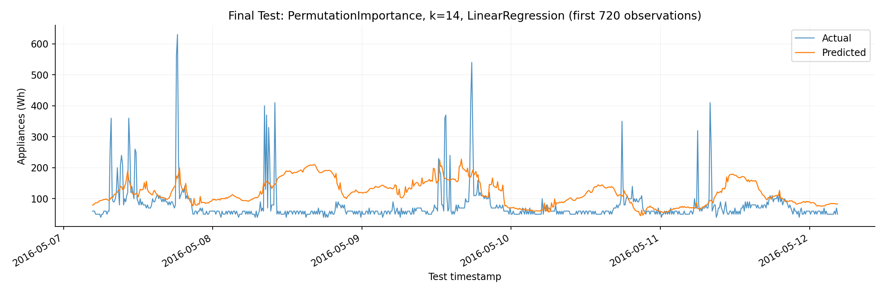

`locked_final_model.joblib` 保存 Train-only scaler、欄位索引、最後模型與此次 Test 指標；`final_best_test_predictions.csv` 保存全部 Test 實測與預測，可用於下一階段殘差檢查（但不可再拿 Test 調參）。

## 12.7 Auto Regression（自回歸延伸）— 事前固定公平對照

### 12.7.1 比較條件

研究目的：原始 25 個環境與照明特徵和目標的單特徵線性相關偏弱，所以增加先前時段的 `Appliances`：

```python
df['Appliances_lag1'] = df['Appliances'].shift(1)  # 前 10 分鐘
df['Appliances_lag2'] = df['Appliances'].shift(2)  # 前 20 分鐘
df['Appliances_lag3'] = df['Appliances'].shift(3)  # 前 30 分鐘
```

| 實驗 | 輸入欄位 | 特徵數 | 回歸模型 |
|---|---|---:|---|
| Environmental only | Step 3 的 25 個環境＋照明特徵 | 25 | `LinearRegression` |
| Environmental + observed lags | 同 25 個＋`lag1`、`lag2`、`lag3` | 28 | `LinearRegression` |

**不可使用 `lag0`（當期 Appliances）**，否則直接洩漏答案。本實驗在完整資料中**先 shift 再依原日期邊界切分**，以確保驗證區間的第一筆可用 Train 尾端已觀測的耗電值；Test 的第一筆可用較早已觀測的 Validation 真實值。移除全體最前面三筆後，AR 的 Training 為 13,811 筆，Validation 與 Test 各保持 2,960／2,961 筆。兩組模型都在這些**完全相同的樣本**上訓練及評估，兩組 scaler **分別只在 AR Training 上 `fit`**。

> **實際部署假設**：這裡使用前 10／20／30 分鐘的真實 `Appliances`，只適用於歷史家電用電量已知且能滾動更新的一步估計。若尚未取得這些值，不能聲稱能達到以下成績；若做多步未來預測，則需要另行規劃遞迴或直接多步模型。本擴充同時也使用當期環境變數，故不是只有 lag 的純 AR 模型，而是 **ARX 型態的線性迴歸對照**。

### 12.7.2 Validation 與 Test 指標（真實運行結果）

| 資料區間 | 實驗 | p | MAE | MSE | RMSE | R² | Adj. R² |
|---|---|---:|---:|---:|---:|---:|---:|
| Validation | EnvironmentOnly_25 | 25 | 54.52 | 7562.42 | 86.96 | 0.1111 | 0.1036 |
| Test | EnvironmentOnly_25 | 25 | 57.51 | 7787.55 | 88.25 | 0.0570 | 0.0489 |
| Validation | EnvironmentPlus3Lags_28 | 28 | 28.86 | 3682.65 | 60.68 | 0.5672 | 0.5630 |
| Test | EnvironmentPlus3Lags_28 | 28 | 28.85 | 3769.77 | 61.40 | 0.5435 | 0.5391 |

- **Validation：**增加 3 個滯後特徵後，R² 提升 **0.4560**（提升 45.60 個百分點），RMSE 從 **86.96** 降到 **60.68 Wh**，約下降 **30.22%**。

- **Test：**增加 3 個滯後特徵後，R² 提升 **0.4865**（提升 48.65 個百分點），RMSE 從 **88.25** 降到 **61.40 Wh**，約下降 **30.42%**。


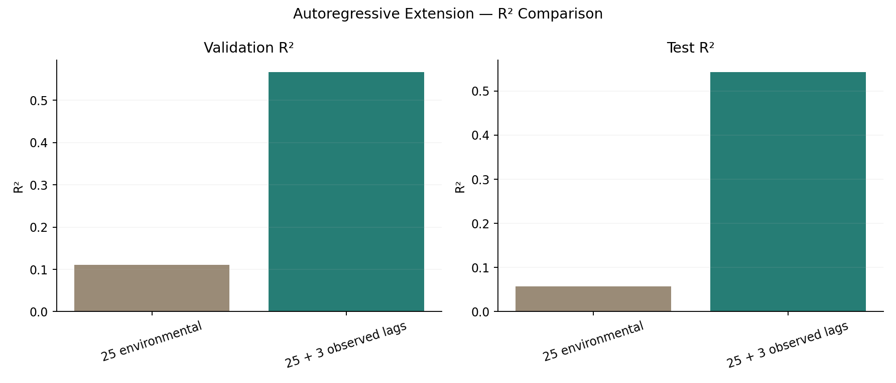

**解釋**：Lag 能利用家電用電的短期持續性，故在連續記錄情境中可能顯著改善估計。但兩個 AR Test 結果屬**事前固定的對照評估**，**不可在看完 Test 後改稱 AR 是原先 45 組選型實驗的最佳勝出組合**；若要把 ARX 當正式部署模型，須將其研究問題、可取得輸入、評估規則及選模型流程清楚另列。

## 12.8 異常／限制與可信度分析

1. **Validation 選型沒有 Test 污染**：scaler 與所有選擇器只以 Training fit；Lasso `alpha`、Ridge `alpha` 為事先固定，不宣稱最佳；SFS 與 Permutation 的二級評估只用 Train 內部資料。
2. **線性關係偏弱**：同時段環境變數不足以完整描述家電的開關、實際家務行為，Test R² 表現不一定好；這不是資料切分錯誤的直接證據。
3. **多重共線性**：即使最好的 Validation 組合，某些特徵仍有很高 VIF，線性回歸係數解釋可能不穩定；這不等於模型絕對不可預測。
4. **時間與分布漂移**：Training / Validation / Test 不同時段；Step 3 已發現 `lights=0` 比例有變，需避免隨機打散資料造成過度樂觀的外推評估。
5. **R² 與 Adjusted R²**：所有評估指標都在分割區間計算；Adjusted R² 的自變數數量以 k 或 25/28 計算，這是解釋量的修正，**不代表驗證集有獨立同分布誤差**。
6. **25 特徵重複設定**：五個選擇器的 k=25 都是相同完整特徵基準；讀報告時不應把它們當獨立方法勝出。
7. **Lag 的真實可用性**：用到前幾個時間點的**已觀測** Target；若只有環境感測器而沒有先前家電用電量，AR 擴充不可部署。
8. **Step 4 當時尚無預測區間（已於 Step 5 補上）**：使用 `statsmodels` 傳統 OLS CI／PI，不以任意正負固定幅度替代；區間有效性仍需依殘差診斷判斷。

## 12.9 可重現程式與結果清單

執行環境使用 Python、pandas、NumPy、Scikit-learn、Matplotlib。這裡的主要結果檔是：

```text
5115056030_step4_feature_selection_modeling.py
5115056030_step4_outputs/
├── validation_model_comparison.csv          # 45 組全指標
├── selected_features.csv                    # 15 組欄位清單
├── vif_summary.csv                         # 15 組 VIF 摘要
├── vif_details.csv                         # 逐特徵 VIF 明細
├── selector_train_only_details.json        # 訓練階段排序分數、SFS/Permutation 配置
├── final_best_test_metrics.json            # Validation 最佳一組的 Test 評估
├── final_best_test_predictions.csv         # 最終 Test 預測（供 Step 5 診斷）
├── autoregression_comparison.csv           # ARX Validation/Test 公平對照
├── ar_*_predictions.csv                     # ARX 每次的實際/預測數值
├── environment_train_fitted_scaler.joblib  # 只在 Training fit
├── locked_final_model.joblib               # 最終鎖定模型
├── ar_experiment_models.joblib              # 固定 ARX 對照模型
├── run_manifest.json                       # 重現資訊與固定超參數
├── step3_confirmed_splits/                 # 與 Step 3 完全一致的 3 份分割檔
├── 01_validation_top16_rmse.png
├── 02_vif_gt10_heatmap.png
├── 03_validation_r2_vs_rmse.png
├── 04_final_best_test_actual_vs_predicted.png
├── 05_ar_rmse_comparison.png
└── 06_ar_r2_comparison.png
```

```bash
pip install pandas numpy scipy scikit-learn matplotlib joblib threadpoolctl
python 5115056030_step4_feature_selection_modeling.py --csv KAG_energydata_complete.csv --out 5115056030_step4_outputs
```

## 12.10 可直接放入報告的「Modeling」段落

本研究依照 CRISP-DM 建模階段，首先將 19,735 筆資料按時間切分為訓練、驗證及測試資料，保留 25 個同時段環境與照明特徵，使用 `StandardScaler` 僅在訓練資料進行參數估計。接著在訓練資料上比較 SelectKBest、RFE、SFS、Lasso 係數排序及 Permutation Importance 五種特徵選擇方法，針對 14、20、25 個輸入特徵分別配合 LinearRegression、Ridge 與 Lasso，形成 45 組驗證集模型設定。SFS 採訓練集內的時間序列交叉驗證，Permutation Importance 使用訓練集內的後段樣本評估變數重要性，以避免正式 Validation 與 Test 資料洩漏。所有模型均以 MAE、MSE、RMSE、R²、Adjusted R² 進行評估，另於訓練資料上計算 VIF 以檢查多重共線性。驗證集表現最佳者為 Permutation Importance 選出的 14 特徵 LinearRegression，Validation RMSE 約 84.71 Wh、R² 約 0.1566；其鎖定後的 Test RMSE 約 89.20 Wh、R² 約 0.0366，顯示模型對不同時間區段的泛化能力仍有限。額外進行的時間滯後實驗在固定的 25 個環境特徵上加入前 10、20、30 分鐘的實際用電量，共計 28 個輸入；在同一批對齊資料上 Test RMSE 從 88.25 Wh 降至 61.40 Wh，Test R² 由 0.0570 提升至 0.5435。此結果支持過去短期用電量對當期用電估計具有重要資訊，但該擴充需以過去實際用電量可取得為應用前提。

## 12.11 GPT 輔助內容／NotebookLM 摘要註記

**GPT 輔助內容（需在正式 PDF 明確標示）**：本階段利用 ChatGPT 協助規劃與撰寫 Train-only 前處理、SelectKBest/RFE/SFS/Lasso/Permutation Importance 比較、VIF 分析、回歸模型 Validation/Test 評估、ARX 對照程式、Markdown 表格與圖表。程式於提供的原始 CSV 上實際執行，並非預估數值。最後正式作業仍需依課堂要求匯出完整 GPT 對話 PDF。

**NotebookLM 摘要（待實際研究）**：本階段並未使用 NotebookLM，不能將此段 ChatGPT 內容冒稱已完成 NotebookLM 100 字以上摘要。先前規劃之 2017 原始研究論文、UCI 資料說明與作者程式，可於下一階段正式提供給 NotebookLM，再依實際使用紀錄整理摘要及比較。

## 12.12 最新進度與下一階段

- [x] Step 1：選題、資料來源、14–39 特徵限制核對。
- [x] Step 2：真實 CSV 19,735 筆資料 EDA、完整欄位與相關性。
- [x] Step 3：A 方案同期估計、時序 70/15/15 切分、25 個環境／照明輸入。
- [x] **Step 4：5 種特徵選擇 × k=14/20/25 × 3 種回歸模型、Training VIF、Validation 選型、Test 最終評估，以及 Lag/ARX 對照。**
- [x] **Step 5：三組鎖定 OLS 模型的線性／獨立／等變異／常態／VIF 診斷，以及 Test 95% CI／PI、432 筆放大圖、整體與分負荷涵蓋率（第 13 節）。**
- [ ] Step 6：透過 NotebookLM 實際研究同題文獻、100 字以上中文摘要與來源比較。
- [ ] Step 7：正式 `5115056030_hw2.py`、報告 PDF、GPT 對話 PDF、NotebookLM 研究內容、最終學號 ZIP。


---

# 13. Step 5 — Evaluation（五大假設檢驗、OLS 95% CI／PI，真實測試集實測）

> **重要：**此章內容均依使用者上傳的 `KAG_energydata_complete.csv` 與 Step 4 鎖定模型／StandardScaler 重建等價的 `statsmodels.OLS` 並實際計算；沒有使用 Test 重新選變數、重新調整 Ridge/Lasso alpha 或挑選好看的 72 小時區段。**主模型 A 是 Step 4 的 Validation 優勝者**；完整 25 環境及 Lag 28 是當時已固定的額外對照，不將 B 冒稱為同一選型賽事的事前最佳模型。

## 13.1 固定研究設計、訓練範圍及可重現性

| 名稱 | 變數來源 | 特徵數 | 訓練筆數 | Test 筆數 | 模型性質 |
|---|---|---:|---:|---:|---|
| A_best14 | Permutation Importance（Training 內選出的 14 個環境與照明特徵） | **14** | **13,814** | **2,961** | 多元線性回歸（同期估計） |
| Env25 | 原 Step 3 全部 25 個環境與照明特徵 | **25** | **13,811** | **2,961** | 公平 Lag 對照基線 |
| B_lag28 | 同 25 特徵 + `Appliances_lag1`、`lag2`、`lag3` | **28** | **13,811** | **2,961** | 含觀測歷史真實耗電量的 ARX 線性回歸 |

- A 是**與 Step 4 最佳模型相同的 14 個欄位、同一已擬合的 25 特徵標準化器及同一 Training**。Scaler 是在 25 欄上 fit，因此轉換 A 時必須先依原順序 transform 25 欄，再依鎖定的索引取 14 欄。
- Env25、B_lag28 採 Step 4 已固定的 Lag 對照實驗設定；完整資料先 `shift(1..3)`，首 3 筆不具完整 Lag 而排除。**兩個控制組使用完全相同的 13,811 筆 Training 與 2,961 筆 Test**。
- `statsmodels.OLS` **只在 Training 上重新擬合數值等價模型以求標準誤與區間**。3 個模型的新 OLS 預測值與原 `scikit-learn.LinearRegression` 的最大差異分別小於 2×10⁻¹² Wh（見 `step5_manifest.json`），不是利用 Test 重新學習或更換模型。
- 五大假設之檢驗優先報告 Training 殘差，另列出 Test 殘差的外部驗證性診斷；**看 Test 的圖／區間涵蓋率只能用於報告，不再回頭調整選模或區間**。
- Lag 由觀測到的前 10／20／30 分鐘 `Appliances` 取得；**不可用當期 `Appliances` 或同一期之後的目標數值**。必須具備連續量測的既往用電，這不是只靠環境感測器預測未來的免費增益。

## 13.2 原來的 Test 預測指標（確認鎖定模型未變）

| 模型 | MAE（Wh） | MSE（Wh²） | RMSE（Wh） | R² | Adjusted R² |
|---|---:|---:|---:|---:|---:|
| A：環境最佳 14 特徵 | 60.17 | 7955.90 | **89.20** | **0.0366** | 0.0320 |
| 對照：完整環境 25 特徵 | 57.51 | 7787.55 | **88.25** | **0.0570** | 0.0489 |
| B：環境 25 + Lag 3 | 28.85 | 3769.77 | **61.40** | **0.5435** | 0.5391 |

**比較方式要正確**：A14 是 Validation 最佳單一模型；B28 改善應主要和 **Env25** 的同批對齊資料比較。從 Env25 的 Test RMSE 88.25 Wh 到 B28 的 61.40 Wh，約下降 **30.42%**；R² 由 0.0570 提升到 0.5435。然而 B28 的可部署前提是可取得上一至三個時點的**真實**家電耗電量。

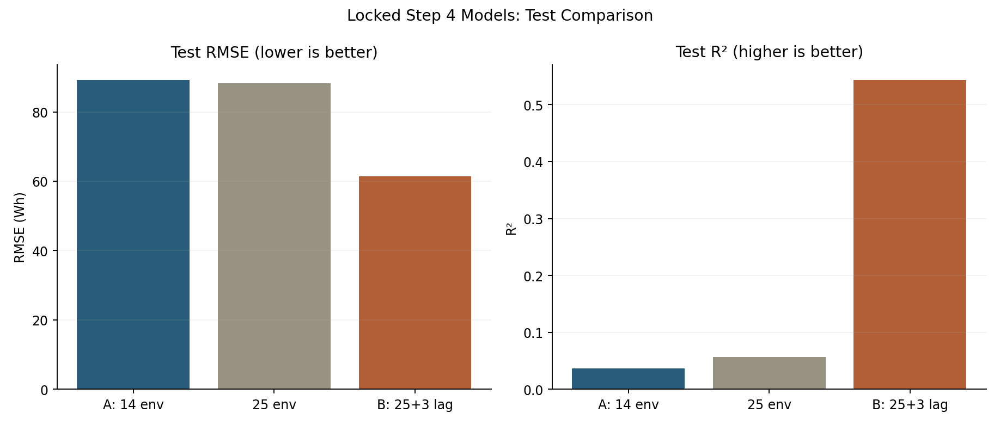

## 13.3 假設一：線性關係 Linearity（視覺診斷）

對 Test 殘差 `e_t = y_t - yhat_t` 繪製 **Residuals vs Fitted**，紅線為依擬合值排序的移動中位數趨勢。檢視是否出現曲線、系統性的偏移、偏低負荷聚集及預測峰值困難等現象。**這是模型形式診斷，不是單靠一張圖就能『證明線性』**。

- **A14／Env25**：高耗電尖峰帶來正向長尾殘差；純環境線性特徵難描述家電瞬間啟停。
- **B28**：加入真實 Lag 後對多數連續穩定時段擬合改善，但遇到突發大耗電仍會產生明顯正殘差；不能據此宣稱線性假設已完全成立。

以下三張每張皆是 **Residual vs Fitted / 殘差 ACF / Histogram / Q–Q** 四聯圖：


[Env25 四聯診斷圖](5115056030_step5_outputs/01_diagnostics_Env25.png)

## 13.4 假設二：誤差獨立性 Independence — DW 與殘差 ACF

Durbin–Watson 定義：

```text
DW = sum((e_t − e_(t−1))²) / sum(e_t²)
```

DW 接近 2 通常代表**一階序列相關較少**；接近 0 偏向正自相關，接近 4 偏向負自相關。DW 不是對全部延遲的獨立性保證，也不能直接把 DW 增量當成具有統計顯著性的兩模型差異檢定。

| 模型 | Train DW | Test DW | Train 殘差 ACF lag1 | Test ACF lag1 | Test ACF lag6（1 小時） |
|---|---:|---:|---:|---:|---:|
| A：環境最佳 14 特徵 | 0.6133 | **0.5831** | +0.6933 | +0.6876 | +0.2787 |
| 對照：完整環境 25 特徵 | 0.6172 | **0.5955** | +0.6913 | +0.6892 | +0.2756 |
| B：環境 25 + Lag 3 | 2.0075 | **2.0704** | -0.0038 | -0.0359 | +0.0866 |

**解讀：**A14 的 Test DW 僅約 **0.583**，一階 ACF 近 **+0.688**，表示嚴重正向一階自相關；B28 的 Test DW 增至 **2.070**，一階 ACF 降至約 **−0.036**，相對於 A14 明顯改善。即使如此，B28 在 lag6 的殘差 ACF 仍約 **+0.087**，不能推論「所有殘差完全獨立」，更不能把改進解釋成正式 DW 檢定的 p-value。兩個資料分割維持時序，不可先 shuffle 再算 DW。

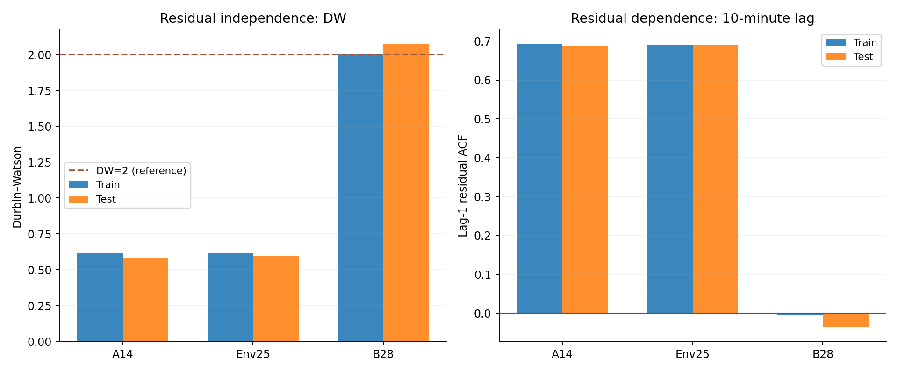

## 13.5 假設三：等變異性 Homoscedasticity — Breusch–Pagan

Breusch–Pagan 的零假設 H0：誤差具有恆定變異數。使用含截距且只在 Training 擬合完成的回歸設計矩陣，計算 LM 值、LM p-value、F 值與 F p-value；此外在 Test 殘差上做**探索性外部診斷**（不拿來調模型）。

| 模型 | 區間 | BP LM | LM p-value | BP F | F p-value |
|---|---|---:|---:|---:|---:|
| A：環境最佳 14 特徵 | Train | 458.83 | 4.84e-89 | 33.86 | 1.26e-90 |
| A：環境最佳 14 特徵 | Test | 254.53 | 3.32e-46 | 19.79 | 1.92e-48 |
| 對照：完整環境 25 特徵 | Train | 484.16 | 1.47e-86 | 20.03 | 2.99e-88 |
| 對照：完整環境 25 特徵 | Test | 285.67 | 4.44e-46 | 12.54 | 9.86e-49 |
| B：環境 25 + Lag 3 | Train | 1099.49 | 1.22e-213 | 42.57 | 3.66e-223 |
| B：環境 25 + Lag 3 | Test | 286.23 | 1.31e-44 | 11.21 | 3.25e-47 |

**結論：**所有模型的 BP p-value 均遠小於 0.05，拒絕等變異零假設，存在明顯**異質變異**。B28 雖改善點預測和一階自相關，並沒有修復等變異性；因此傳統不分負荷大小、近乎固定寬度的 PI 可能具有結構性失準。注意：在殘差自相關尚存時，常規檢定 p-value 仍受其假設限制，建議把視覺化與 p-value 合併解讀。

## 13.6 假設四：殘差常態性 Normality — 偏態、峰度、JB、Omnibus

下表的 Kurtosis 採 **Excess kurtosis**（常態分布值為 0）。Jarque–Bera 和 Omnibus 的 H0 為殘差服從常態分布；p-value 計為 0 時，是極小數**浮點下溢**，並不是數學上絕對為零。

| 模型 | 區間 | Skewness | Excess Kurtosis | Jarque–Bera | JB p-value | Omnibus | Omnibus p-value |
|---|---|---:|---:|---:|---:|---:|---:|
| A：環境最佳 14 特徵 | Train | 3.217 | 13.536 | 129187.7 | ≈0（數值下溢） | 9477.5 | ≈0（數值下溢） |
| A：環境最佳 14 特徵 | Test | 3.157 | 14.122 | 29428.6 | ≈0（數值下溢） | 2040.7 | ≈0（數值下溢） |
| 對照：完整環境 25 特徵 | Train | 3.222 | 13.624 | 130620.4 | ≈0（數值下溢） | 9494.8 | ≈0（數值下溢） |
| 對照：完整環境 25 特徵 | Test | 2.960 | 13.063 | 25294.0 | ≈0（數值下溢） | 1932.9 | ≈0（數值下溢） |
| B：環境 25 + Lag 3 | Train | 3.134 | 21.486 | 288054.3 | ≈0（數值下溢） | 9958.1 | ≈0（數值下溢） |
| B：環境 25 + Lag 3 | Test | 3.211 | 21.691 | 62927.9 | ≈0（數值下溢） | 2193.9 | ≈0（數值下溢） |

**結論：**A14、Env25、B28 的 Test 殘差均顯著右偏（偏態約 3），厚尾且 Q–Q 圖明顯偏離常態直線；B28 的 Test 超額峰度甚至達到 **21.69**。殘差非常態的問題沒有因加入 Lag 消失。樣本很多時檢定極敏感，因此不能只看 p-value，必須配合 Q–Q 與 Histogram。

## 13.7 假設五：多重共線性 No severe Multicollinearity — VIF

VIF 僅以 **Training** 計算，每個自變數 j 使用其他自變數解釋它的輔助迴歸 R²_j，`VIF_j = 1 / (1−R²_j)`；VIF > 5 / > 10 僅是常見經驗篩查門檻。

| 模型 | k | Max VIF | Median VIF | VIF > 5 | VIF > 10 | 最嚴重欄位 |
|---|---:|---:|---:|---:|---:|---|
| A：環境最佳 14 特徵 | 14 | **382.45** | 8.07 | 11 | 5 | `T_out` |
| 對照：完整環境 25 特徵 | 25 | **404.84** | 9.99 | 19 | 12 | `T_out` |
| B：環境 25 + Lag 3 | 28 | **405.34** | 8.95 | 19 | 13 | `T_out` |

**判定：**環境模型 A14 經特徵選擇後，最大 VIF 從 Env25 的約 **404.84** 下降到約 **382.45**，但仍非常高，不能說已解決共線性。B28 的最大 VIF 約 **405.34**，也沒有改善這個問題。此結果限制個別係數的穩定解釋與傳統 CI 可信度，但不代表 OLS 點預測一定完全無效。

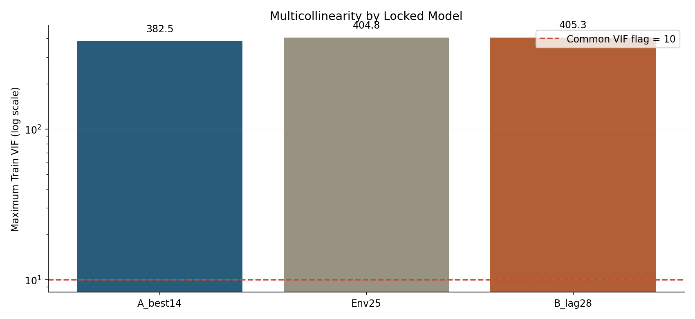

完整逐欄 VIF 見 `vif_train_details.csv`，前三個高 VIF 欄多為 `T_out`、`Tdewpoint`、`RH_out`，反映強烈的氣象變數關聯。

## 13.8 以 OLS 計算 Test 95% CI 與 95% PI

傳統 OLS 在設計矩陣含截距的情況下，對測試輸入向量 x₀（含截距）給出的模型條件平均預測是 yhat = x₀ᵀ beta_hat。令 s² 為訓練殘差估計變異數、t* 為適當的 95% t 臨界值，則：

```text
Mean CI: yhat ± t* × sqrt( s² × x₀ᵀ (XᵀX)^(-1) x₀ )
Single-observation PI: yhat ± t* × sqrt( s² × [1 + x₀ᵀ (XᵀX)^(-1) x₀] )
```

程式使用 `statsmodels.OLS(...).fit().get_prediction(X_test).summary_frame(alpha=0.05)`，取得 `mean_ci_lower`、`mean_ci_upper` 以及 `obs_ci_lower`、`obs_ci_upper`。完整設計矩陣僅來自原 Step 4 Training：不在 Test 估計 s 或重新 fit。**傳統公式假設均值模型正確、同方差、沒有自相關，且採常態殘差近似；上面檢驗已指出部分前提不滿足**。

**CI 與 PI 的差別**：95% CI 描述輸入條件下**平均值**估計的不確定性，理論上較窄；95% PI 才是對**單筆家電耗電量**的預測區間。不能要求 95% 的獨立實際點落在「平均值 CI」內；報告的 Coverage 主要根據 PI 計算。

| 模型 | Test 筆數 | 95% PI 實測涵蓋率 | 平均 PI 寬度（Wh） | 平均 CI 寬度（Wh） | PI 下界 < 0 筆數 | PI 低於下界／高於上界 |
|---|---:|---:|---:|---:|---:|---:|
| A：環境最佳 14 特徵 | 2961 | **96.49%** | 384.21 | 22.17 | 2,827 (95.47%) | 0 / 104 |
| 對照：完整環境 25 特徵 | 2961 | **96.49%** | 382.74 | 26.95 | 2,829 (95.54%) | 4 / 100 |
| B：環境 25 + Lag 3 | 2961 | **95.47%** | 268.07 | 19.20 | 2,582 (87.20%) | 42 / 92 |

- A14 整體 95% PI 涵蓋率 **96.49%**，但 Test 中 **2,827 / 2,961** 個觀測點的 PI 下界小於 0 Wh，對用電量不合理。
- B28 的 PI 較窄（平均 **268.07 Wh**，相較 A14 的 **384.21 Wh**），整體涵蓋率仍約 **95.47%**；但有 **2,582 / 2,961（87.20%）** 個點的 PI 下界小於 0 Wh。
- **整體 coverage ≈ 95% 不保證條件 coverage 良好**，尤其不同耗電水準下很不均衡，詳見下一節。若未來要修正區間，可研究非負限制、條件分位數、適當時序分割的 Conformal Prediction、或符合資料結構的 Bootstrap；**以上均未在 Step 5 執行，不可宣稱已改善校準**。

### 13.8.1 全 Test 與連續 72 小時局部放大

Test 共 2,961 筆；局部視窗**固定選擇 Test 的前 432 個連續 10 分鐘樣本 = 72 小時**，以避免挑選特別好看的測試片段。灰黑線是實際值、實色線是預測、藍色帶是 95% 平均 CI、橘色帶是 95% 單筆 PI。所有圖均有 0 Wh 參考線，用來凸顯 PI 下界為負值的問題。

**方案 A：最佳 14 環境特徵**


[查看 A14 全 Test 時間概覽](5115056030_step5_outputs/02_intervals_A_best14_overview.png)

**方案 B：25 個環境特徵 + 3 個觀測 Lag**


[查看 B28 全 Test 時間概覽](5115056030_step5_outputs/02_intervals_B_lag28_overview.png) · [環境 25 特徵對照模型的 72 小時圖](5115056030_step5_outputs/02_intervals_Env25_72h_zoom.png)

## 13.9 分耗電量區間的 95% PI 真實涵蓋率

各區間按**實際** Test 耗電量劃分（僅用於事後診斷，不用來調參）。四組分別為 `<=100`、`(100,200]`、`(200,400]`、`>400` Wh；同一 Test 的分組筆數依序為 2332、381、179、69，合計 2961。

| 實際耗電區間 | N | A14 PI 涵蓋率 | Env25 涵蓋率 | B28 涵蓋率 |
|---|---:|---:|---:|---:|
| ≤ 100 Wh | 2332 | 100.00% | 99.83% | **99.40%** |
| 100–200 Wh | 381 | 100.00% | 100.00% | **95.54%** |
| 200–400 Wh | 179 | 80.45% | 82.68% | **71.51%** |
| > 400 Wh | 69 | 0.00% | 0.00% | **24.64%** |

- A14 對 **≤100 Wh** 的資料，PI 幾乎無差別地涵蓋所有點（100%），但對 **>400 Wh** 的 69 筆資料卻 **0%** 落入 PI。
- B28 雖使 >400 Wh 尖峰涵蓋率由 0% 改進至 **24.64%（17／69）**，仍離宣稱的 95% 水準很遠；對 ≤100 Wh 的 2332 筆則高達 **99.40%**，表示 PI 在低負荷大幅保守、對極端負荷嚴重低估不確定性。
- 由於樣本絕大多數屬低負荷，**整體加權平均的 95.47% 掩蓋了高耗電群體的失準**。以負荷區間評估才能看見這個問題。


### 13.9.1 為什麼傳統 OLS PI 在這份資料並不可靠？

1. **時間自相關（Independence 違反）**：A14 的正序列自相關嚴重，使模型估計有效獨立觀測數高估，傳統係數 SE 與 mean CI 可能低估真實不確定性。B28 顯著改善一階 DW，但較長延遲仍不全為零。
2. **異質變異（Homoscedasticity 違反）**：BP 檢驗強烈拒絕恆定誤差變異。傳統公式主要透過全 Train 的單一 s² 計算 PI，低耗電時太寬、高負荷時太窄。
3. **右偏／厚尾與突發尖峰（Normality 違反）**：家電瞬間開關讓誤差極端偏正，單一常態誤差近似無法覆蓋所有高負荷尖峰。即使 DW 接近 2，高負荷的 PI coverage 仍遠低於 95%。
4. **非負物理限制**：家電能耗 Wh ≥ 0，但不受限的線性 OLS 及其對稱 CI／PI 可以產生負下界；Test 中 B28 約 87% 的 PI 下界為負，不能直接當作物理可行的用電區間。截為 0 是展示上的物理修正，並不是經過校準、可以保證 95% coverage 的新區間。
5. **特徵高度相關**：A14 的 Max VIF 仍約 382，增加係數估計不穩定性，無法靠選到 14 欄就認定已根治。

## 13.10 五大假設總結與 CRISP-DM Evaluation 判斷

| 假設 | A14 環境模型 | B28 ARX 延伸模型 | 核心依據 |
|---|---|---|---|
| 線性形式 | 可能不足 | 改善但仍有尖峰失配 | Test Residuals vs Fitted、趨勢線 |
| 誤差獨立性 | **明顯違反** | **一階自相關大幅改善，非全延遲獨立** | DW 約 0.583 → 2.070、Test ACF lag1 約 +0.688 → −0.036 |
| 等變異性 | **拒絕** | **拒絕** | Train/Test BP LM p-value 均极小 |
| 常態性 | **拒絕** | **拒絕** | Skew 約 3、超額峰度遠大於 0、JB/Omnibus p≈0、Q–Q |
| 無嚴重共線性 | **不滿足** | **不滿足** | 最大 Train VIF 約 382／405 |

**整體結論：**ARX 模型明顯改善在具備歷史真實耗電資料時的同期估計能力，並使殘差的一階相關幾乎消失，然而並未修復殘差右偏、厚尾、異質變異與輸入共線性問題。傳統 OLS Test PI **整體**雖接近名目 95%，**高負荷尖峰的條件 coverage 大幅不足**，因此不能宣稱「模型符合所有回歸假設」或「PI 95% 可靠」。這是完整的 Evaluation 分析，不以 p-value 或漂亮的總平均掩蓋模型限制。

## 13.11 可重現檔案、步驟與結果核對

```bash
pip install numpy pandas scipy matplotlib scikit-learn statsmodels joblib
python 5115056030_step5_evaluation.py \
  --csv KAG_energydata_complete.csv \
  --step4 5115056030_step4_outputs \
  --out 5115056030_step5_outputs
```

Step 5 輸出目錄：

```text
5115056030_step5_outputs/
├── diagnostics_statistics.csv                  # Train+Test，DW/BP/JB/Omnibus/ACF
├── vif_train_details.csv                      # 三模型逐特徵 VIF
├── vif_model_summary.csv                      # Max/Median/counts
├── coverage_by_load.csv                       # 全 Test 與四區間真實涵蓋率
├── model_metrics_and_intervals.csv            # MAE/RMSE/R²/95% PI 與 CI 統計
├── residual_acf.csv                           # 每模型 Train/Test lag 0~48 ACF
├── predictions_with_intervals_A_best14.csv    # Test 每點實際值/預測/CI/PI
├── predictions_with_intervals_Env25.csv
├── predictions_with_intervals_B_lag28.csv
├── step5_manifest.json                        # 模型核對與研究設計
├── 01_diagnostics_A_best14.png                # Resid/Fitted、ACF、Hist、QQ
├── 01_diagnostics_Env25.png
├── 01_diagnostics_B_lag28.png
├── 02_intervals_{A_best14,Env25,B_lag28}_{overview,72h_zoom}.png   # 6 張
├── 03_test_metrics_comparison.png
├── 04_residual_independence_comparison.png
├── 05_PI_coverage_by_load.png
└── 06_VIF_comparison.png
```

**圖檔合計 13 張**（三張四聯診斷、三模型×全景/72h 共六張、比較圖四張）。訓練數值等價核對在 `step5_manifest.json`：statsmodels OLS 三模型預測均與 Step 4 sklearn 鎖定值一致至浮點誤差量級。使用的 **95% CI 是平均值區間、95% PI 是個別新觀測區間**；這一點不可在 PDF 報告中混淆。

統計方法參考：
- statsmodels OLS 官方範例：https://www.statsmodels.org/stable/examples/notebooks/generated/ols.html
- statsmodels 回歸診斷說明：https://www.statsmodels.org/dev/diagnostic.html
- 原始資料集：https://archive.ics.uci.edu/dataset/374/appliances+energy+prediction

## 13.12 可直接用於正式報告的 Evaluation 摘要

本研究延續前階段以驗證集選出的 Permutation Importance 14 特徵 LinearRegression（方案 A），並以含 25 個環境與照明特徵的控制模型、以及增加前 10／20／30 分鐘真實耗電量的 28 特徵 ARX 線性回歸（方案 B）作對照。所有標準化與模型擬合均僅使用原訓練資料，並透過 statsmodels OLS 重建數值等價模型取得 95% 平均值信賴區間與個別預測區間。方案 A 的測試 R² 為 0.0366、RMSE 約 89.20 Wh；方案 B 的 R² 達 0.5435、RMSE 約 61.40 Wh。殘差診斷發現，方案 A 測試 Durbin–Watson 約 0.583，存在明顯正向自相關；加入 Lag 後方案 B 提升至 2.070，一階殘差相關大幅降低。然而 Breusch–Pagan、Jarque–Bera 及 Omnibus 顯示三模型仍存在異質變異與非正態殘差，且最大 VIF 約 382–405，特徵共線性仍嚴重。傳統 OLS 95% PI 在測試集整體涵蓋率約為方案 A 的 96.49% 與方案 B 的 95.47%，但對實際耗電 >400 Wh 的高負荷資料僅分別涵蓋 0% 與 24.64%；方案 B 更有約 87.20% 的預測區間下界小於 0 Wh，違反能耗非負的物理意義。由此可知，加入歷史用電資訊雖改善多元線性回歸的點預測與一階殘差自相關，但傳統 OLS 區間的整體涵蓋率不能保證每個負荷區間都可靠，未來應研究能處理條件變異、尖峰及時間依賴的區間方法。

## 13.13 GPT 輔助內容、NotebookLM 與最終作業進度

**GPT 輔助內容：**使用 ChatGPT 協助保留 Step 4 模型固定邊界、產生 statsmodels 五大假設診斷、傳統 95% CI/PI、涵蓋率分群與 CSV／PNG／Markdown 報告。程式已在真實 CSV 執行；**完整 ChatGPT 對話仍需使用 PDF 匯出功能另外保留**。

**NotebookLM 摘要：尚未實際執行 NotebookLM。** 此段不可替代課堂要求的 100 字以上真實 NotebookLM 文獻摘要。待完成 Step 6 後才能加入正式 PDF 中。

- [x] Step 1：資料集與作業限制評估。
- [x] Step 2：Data Understanding 真實資料探索。
- [x] Step 3：Data Preparation／固定 25 特徵候選池及時間切分。
- [x] Step 4：五種特徵選擇、45 組模型、單次 Test／Lag 對照。
- [x] **Step 5：五大迴歸假設檢驗、三模型比較、95% CI／PI、432 筆 72h 局部圖、涵蓋率分析。**
- [ ] Step 6：NotebookLM 真實文獻研究與對比，新增至少 100 字摘要。
- [ ] Step 7：`5115056030_hw2.py` 整合、完整 CRISP-DM PDF、GPT 對話 PDF、正式 `5115056030_hw2.zip` 繳交。


---

# 14. Step 6：Deployment、NotebookLM 摘要、文獻研究與最終交付（v6）

> **版本 v6（2026-10-15）**：前述 Step 1–5 章節皆保留原樣，Step 6 已實際執行鎖定模型的 Pipeline 重新載入／真實 Test 樣本推論。以下內容並已整合於正式 `5115056030_hw2_report.md` 與 PDF。先前文字標示 NotebookLM「待研究」是當時階段的歷史記錄；此次使用者已明確提供其完成的 NotebookLM 摘要。

## 6. Deployment（模型部署與新樣本推論）

已將鎖定 Step 4 的 scaler、14 個特徵選擇器及 LinearRegression 包成可由 `joblib.load` 載入的 `sklearn.Pipeline`（方案 A）；方案 B 為 scaler + 28 特徵 LinearRegression Pipeline。**沒有使用 Test 重新擬合 scaler／特徵／模型**；只使用原 Training 的觀測重新建立數值等價的 `statsmodels.OLS`，用於傳統 CI/PI 推論。載入存檔 Pipeline 後逐筆檢查，與原鎖定模型預測值一致。需注意：`joblib.load` 使用 pickle 機制，只能載入可信來源檔案。

### 6.1 低負荷與尖峰樣本實測

從 Test 中以實際負荷與照明選取 3 筆低負荷、3 筆已發生尖峰作**事後展示**，不作模型選擇或調參。若實際系統部署，不能依未觀測的真實 `Appliances` 先選樣本。


| 日期／情境 | Actual | 模型 | 點預測 (Wh) | 95% PI 下界 | 95% PI 上界 |
| --- | --- | --- | --- | --- | --- |
| 2016-05-07 04:40／低負荷 | 60 | A-14 | 79.56 | -112.25 | 271.37 |
| 2016-05-07 04:40／低負荷 | 60 | B-28 | 63.40 | -70.37 | 197.16 |
| 2016-05-07 04:50／低負荷 | 60 | A-14 | 80.66 | -111.15 | 272.46 |
| 2016-05-07 04:50／低負荷 | 60 | B-28 | 58.15 | -75.61 | 191.91 |
| 2016-05-07 05:00／低負荷 | 60 | A-14 | 84.07 | -107.73 | 275.87 |
| 2016-05-07 05:00／低負荷 | 60 | B-28 | 60.94 | -72.82 | 194.70 |
| 2016-05-07 18:10／已觀測尖峰 | 560 | A-14 | 173.41 | -19.62 | 366.44 |
| 2016-05-07 18:10／已觀測尖峰 | 560 | B-28 | 118.05 | -16.63 | 252.73 |
| 2016-05-09 17:40／已觀測尖峰 | 540 | A-14 | 181.83 | -11.22 | 374.88 |
| 2016-05-09 17:40／已觀測尖峰 | 540 | B-28 | 359.18 | 224.34 | 494.03 |
| 2016-05-13 08:00／已觀測尖峰 | 660 | A-14 | 153.15 | -38.81 | 345.10 |
| 2016-05-13 08:00／已觀測尖峰 | 660 | B-28 | 488.30 | 354.18 | 622.42 |


**係數貢獻解釋：**對經訓練期平均／標準差標準化的特徵，單筆預測可寫成 `intercept + Σ(coef_i × z_i)`，其中 `z_i=(x_i − TrainMean_i)/TrainSD_i`。每個貢獻項及原值皆已輸出 `demo_feature_contributions.csv`。由於特徵共線性高，係數貢獻只描述此模型運算結果，不代表改變單一室溫會因果改變該幅度的耗電量。

### 6.2 HEMS 系統情境、操作限制與風險

- **方案 A**：感測器溫濕度／氣象與同期照明量測已經取得時，估計同一時段的電器負荷，可用於基載趨勢探索、缺值合理性初判或感測器訊號異常的輔助指標，但其低 Test R² 與高峰失準使其**不適合單獨**做關鍵安全判斷。
- **方案 B**：若有真實時間序列電表，系統可保留最近 3 個 10 分鐘時段的 `Appliances` 實測值，結合同期其他感測器提供**連續更新的負荷估計／輔助預警**。**需先取得滯後用電量**，沒有真實滯後數據不得把當期預測值冒充歷史測量值；如果連續遞迴預測須另做多步驗證。
- **輸入管控**：按 `deployment_schema.json` 的 feature order、單位及數值型態送入，禁止將 Target 或 `date` 當環境特徵；日期用來排序與 lag 對齊。必須監測時間間隔、遺漏值、感測器故障及跨季節分布漂移。
- **PI 警告**：大量負下界與負荷尖峰 coverage 不足，不能將傳統 OLS PI 直接當作具有 95% 校準保證的警報區間；展示時可以保留負值說明模型限制，但實務呈現應另行設計物理限制與校準方法。

### 6.3 實際部署輸出

`5115056030_step6_outputs/HEMS_environment_14_pipeline.joblib` 和 `HEMS_lag_28_pipeline.joblib` 可供再次載入推論；`deployment_schema.json` 定義欄位順序；`demo_predictions_95PI.csv` 收錄個別 CI／PI；`demo_feature_contributions.csv` 收錄所有標準化係數貢獻與截距；PNG 是本研究實測結果。專案主程式 `5115056030_hw2.py` 亦能從原始 CSV 重新執行六階段。


## 7. 學術來源、NotebookLM 研究與方法對照


### 【NotebookLM 摘要】網路同主題解法與原始文獻研究

> 本研究透過 Google NotebookLM 彙整 UCI 原始文獻（Candanedo et al., 2017）與 Kaggle 社群高分公開解法。
>
> 1. **問題背景與特徵特性**：本研究資料集涵蓋低能耗住宅 4.5 個月之室內溫濕度（`T1`~`T9`、`RH_1`~`RH_9`）、室外氣象與兩個無關隨機變數（`rv1`, `rv2`）。目標變數 `Appliances` 呈強烈右偏分布（待機基載約 40~60 Wh，尖峰高達 1,080 Wh）；且特徵存在嚴重多重共線性（如 `rv1` 與 `rv2` 完全共線、室內外溫濕度高度相關）。
> 2. **傳統線性回歸瓶頸**：單純利用環境溫濕度進行 OLS、Ridge 或 Lasso 多元線性回歸時，測試集解釋力（$R^2$）僅約 0.05~0.16。主因是家電開關屬非線性階躍變化，線性模型無法捕捉突發尖峰，且殘差具強烈正自相關與異質變異，嚴重違反了傳統回歸假設。
> 3. **特徵工程與選擇**：主流解法透過 RFE 或 Lasso 成功剔除無統計顯著性的隨機變數（`rv1`, `rv2`）。加入時間週期特徵（如距離午夜秒數 NSM、小時）能捕捉居民日常作息規律；導入自回歸**滯後項（Lag features）**則顯著利用相鄰時間的強慣性，使線性模型的 $R^2$ 躍升至 0.55~0.60 以上。
> 4. **主流與更優解法比較**：相較於線性模型，非線性集成樹模型（如 Random Forest、GBM 與 XGBoost）能自動學習時間與溫濕度的非線性交互作用，測試集 $R^2$ 提升至 0.57 以上（RMSE 降至約 66 Wh），大幅突破傳統回歸之預測瓶頸。

**摘要來源說明：**以上四項為學生本人提供的 **Google NotebookLM 研究摘要原文**，由 GPT 協助排版。下方原始論文數字另有逐頁核實；摘要中的概括值不全都對應本研究或原論文的同一模型與資料切分，請以各表格標註的來源為準。NotebookLM 原始筆記連結及問答畫面目前未提供，需由學生自行保存佐證。特別是：本研究的 Lag Test $R^2=0.5435$（未達「0.55 以上」）；原始論文 RF Test $R^2=0.54$，不是全部樹模型都超過 0.57；原論文並**未**在其四模型比較中報告 XGBoost。`rv1` 和 `rv2` 是我們於建模前依已知隨機欄位排除，不能宣稱其由本研究 RFE/Lasso 自動剔除。


### 本研究實測模型 vs. 原始論文與網路主流更優解法綜合比較表

本研究的三組 Test 皆使用 **2016/05/07–05/27 的時序保留資料（2,961 筆）**。Candanedo et al. (2017) 的測試集及模型特徵工程不同，文獻 Table 5 論文**完整模型**包含 NSM／星期／週末等週期特徵；不是本文的 14、25 或 28 個特徵，也不是同樣的切分。以下只作**方法與量級對照**，不跨資料切分宣稱優劣或直接合併排名。


| 模型名稱與數據來源 | 特徵配置 | Test RMSE (Wh) | Test R² | 優／缺點 | 統計假設特性 |
| --- | --- | --- | --- | --- | --- |
| 本研究 A：OLS | 14 環境／照明特徵 | 89.20 | 0.0366 | 可解釋；高峰低估 | VIF 高；自相關、異方差、非正態 |
| 本研究 Env：OLS | 25 環境／照明特徵 | 88.25 | 0.0570 | 全特徵基線；簡單 | 同上 |
| 本研究 B：ARX-OLS | 25 環境＋3 實測滯後 | 61.40 | 0.5435 | RMSE 下降、一階自相關改善 | DW 接近 2；仍異方差、厚尾、高 VIF |
| 原論文 LM | 環境＋照明＋NSM／日期 | 93.18 | 0.16 | 傳統線性基線 | 論文未提供本報告相同五項診斷 |
| 原論文 SVM Radial | 同論文全特徵 | 70.74 | 0.52 | RBF 可處理非線性 | 無 OLS 五假設之直接適用性 |
| 原論文 GBM | 同論文全特徵 | 66.65 | 0.57 | 樹集成捕捉非線性尖峰 | 不同於 OLS；可解釋性較低 |
| 原論文 RF | 同論文全特徵 | 68.48 | 0.54 | 非線性／交互作用建模 | 不同於 OLS；個別係數不存在 |
| 2023 後續研究 XGB | 另一文獻處理與切分 | 63.86 | 0.61 | 梯度提升，調參需求高 | 非原論文模型；不同分割不可直接排名 |


原論文資料出處：Candanedo, L. M., Feldheim, V., & Deramaix, D. (2017). *Data driven prediction models of energy use of appliances in a low-energy house*, *Energy and Buildings*, 140, 81–97. **Table 5（期刊頁碼 91）**，DOI: https://doi.org/10.1016/j.enbuild.2017.01.083 ，公開全文：https://orbi.umons.ac.be/bitstream/20.500.12907/23357/1/1-s2.0-S0378778816308970-main.pdf 。

後續研究：*Data-Driven Modeling of Appliance Energy Usage*, *Energies* 2023，Table 2，https://www.mdpi.com/1996-1073/16/22/7536 。此研究的 XGB 63.86 Wh／R² 0.61 為**該文自身測試結果**，非本研究實跑，也非 2017 原論文數據；此例純屬研究背景。


### 【GPT 輔助內容】AI 協作歷程說明

1. **Step 1 — Business Understanding：**協助核對 Kaggle 特徵數限制（14–39，不含 Target），辨別同時間點估計與未來預報的不同，以及研究目的與 CRISP-DM 規格。
2. **Step 2 — Data Understanding：**提供欄位字典、EDA 程式、缺失值／重複值／分布／Pearson 相關矩陣與統計結果核對，依實際原始 CSV 製圖。
3. **Step 3 — Data Preparation：**討論依時間 70/15/15 切分、移除重複的 `rv1`／`rv2`、嚴格限制 25 個候選特徵、避免 Train/Validation/Test 洩漏，及 Pipeline scaler 的訓練集擬合原則。
4. **Step 4 — Modeling：**協作撰寫與驗證五種特徵選擇（SelectKBest、RFE、SFS、Lasso、Permutation Importance）、14／20／25 特徵、三種回歸與 VIF 比較；依 Validation 選模型並進行 Lag 延伸實驗。
5. **Step 5 — Evaluation：**協助 statsmodels OLS 五大假設診斷（DW、ACF、BP、Q–Q、JB／Omnibus、VIF）、傳統 95% CI／PI、72 小時放大圖與 PI 負荷分組涵蓋率驗證。
6. **Step 6 — Deployment：**協助將鎖定模型封裝為可載入的 sklearn Pipeline、測試低負荷與尖峰樣本、點預測與區間、係數貢獻拆解及 HEMS 使用限制。
7. **文獻與編排：**GPT 將學生本人提交的 NotebookLM 摘要放入報告，另依原始論文 Table 5 查對 LM/SVM/GBM/RF 真實數值；協助報告、README 與提交結構。**GPT 並未代替學生操作 NotebookLM**。

> **另需提供完整 GPT 對話紀錄 PDF**：本報告的「GPT 輔助內容」說明並不等同課堂要求的全程對話 PDF，請學生使用 ChatGPT 分享／列印或 pdfCrowd 匯出實際對話，並於最後 ZIP 中加入。此處不會編造或偽造未取得的對話紀錄。


## 8. Conclusion 與作業要求檢查

已完成完整 CRISP-DM：選題與問題定義、原始資料品質檢查、時間切分、5 種 Feature Selection、45 組 LinearRegression／Ridge／Lasso 比較、最終 Test、五大假設、95% CI／PI、Lag 延伸對照，以及部署 Pipeline 的重新載入與實際預測示範。純環境模型的泛化解釋力有限，而加入真實歷史耗電的線性模型大幅改善 RMSE 與一階殘差相關，但並未解決極端負荷的區間可靠性及共線性。未來研究可依季節與負荷區間校準、分析遺漏資料、比較具可解釋性的非線性方法，但不宣稱已部署於真實 HEMS。

**提交清單**：`5115056030_hw2.py`、`5115056030_hw2_report.md`、`5115056030_hw2_report.pdf`、完整資料集、模型與圖檔、兩個明示的 AI 協作區塊、NotebookLM 研究摘要、其他結果資料。**尚須學生本人另行附上完整 ChatGPT 對話 PDF**，再提交最終 ZIP。

### 參考文獻與資料來源

1. Candanedo, L. M., Feldheim, V., & Deramaix, D. (2017). *Data driven prediction models of energy use of appliances in a low-energy house*. *Energy and Buildings*, 140, 81–97. https://doi.org/10.1016/j.enbuild.2017.01.083 （見全文 Table 5）。
2. UCI Appliances Energy Prediction, https://archive.ics.uci.edu/dataset/374/appliances+energy+prediction
3. Kaggle Appliances Energy Prediction, https://www.kaggle.com/datasets/loveall/appliances-energy-prediction
4. 原作者公開程式：https://github.com/LuisM78/Appliances-energy-prediction-data
5. *Data-Driven Modeling of Appliance Energy Usage*, *Energies* (2023), https://www.mdpi.com/1996-1073/16/22/7536
6. statsmodels OLS Reference: https://www.statsmodels.org/stable/regression.html


## 附錄 A：15 組特徵集合與 VIF 摘要（僅 Training 計算）


| Selector | k | Max VIF | VIF > 10 | Median VIF |
| --- | --- | --- | --- | --- |
| SelectKBest | 14 | 26.36 | 3 | 5.51 |
| SelectKBest | 20 | 27.41 | 7 | 7.50 |
| SelectKBest | 25 | 404.83 | 12 | 9.99 |
| RFE | 14 | 364.74 | 9 | 12.72 |
| RFE | 20 | 384.16 | 11 | 11.52 |
| RFE | 25 | 404.83 | 12 | 9.99 |
| SFS | 14 | 366.27 | 6 | 7.74 |
| SFS | 20 | 383.22 | 6 | 6.59 |
| SFS | 25 | 404.83 | 12 | 9.99 |
| Lasso | 14 | 23.63 | 8 | 11.84 |
| Lasso | 20 | 27.57 | 9 | 7.49 |
| Lasso | 25 | 404.83 | 12 | 9.99 |
| Permutation | 14 | 382.45 | 5 | 8.07 |
| Permutation | 20 | 391.45 | 9 | 8.57 |
| Permutation | 25 | 404.83 | 12 | 9.99 |


## 附錄 B：45 組 Validation 指標完整表

以下數值僅來自 Validation，若需要精確的小數及被選特徵清單，參見 `5115056030_step4_outputs/validation_model_comparison.csv` 與 `selected_features.csv`。


| Selector | k | 模型 | MAE | MSE | RMSE | R² | Adjusted R² |
| --- | --- | --- | --- | --- | --- | --- | --- |
| Permutation | 14 | LinearRegression | 50.88 | 7175.3 | 84.71 | 0.1566 | 0.1526 |
| Permutation | 14 | Ridge | 51.34 | 7209.5 | 84.91 | 0.1526 | 0.1486 |
| SFS | 20 | Lasso | 46.50 | 7251.6 | 85.16 | 0.1477 | 0.1419 |
| SFS | 20 | Ridge | 47.02 | 7258.9 | 85.20 | 0.1468 | 0.1410 |
| SFS | 20 | LinearRegression | 47.30 | 7266.6 | 85.24 | 0.1459 | 0.1401 |
| Permutation | 20 | LinearRegression | 50.51 | 7266.6 | 85.24 | 0.1459 | 0.1401 |
| Permutation | 20 | Ridge | 50.87 | 7287.8 | 85.37 | 0.1434 | 0.1376 |
| Permutation | 14 | Lasso | 52.25 | 7288.4 | 85.37 | 0.1434 | 0.1393 |
| Permutation | 20 | Lasso | 51.48 | 7343.8 | 85.70 | 0.1368 | 0.1310 |
| RFE | 14 | Ridge | 53.40 | 7429.3 | 86.19 | 0.1268 | 0.1226 |
| RFE | 14 | LinearRegression | 52.85 | 7431.9 | 86.21 | 0.1265 | 0.1223 |
| RFE | 14 | Lasso | 54.70 | 7517.1 | 86.70 | 0.1165 | 0.1123 |
| SelectKBest | 20 | LinearRegression | 54.28 | 7520.8 | 86.72 | 0.1160 | 0.1100 |
| SelectKBest | 20 | Ridge | 54.24 | 7524.6 | 86.74 | 0.1156 | 0.1096 |
| SelectKBest | 20 | Lasso | 54.29 | 7539.5 | 86.83 | 0.1138 | 0.1078 |
| Lasso | 25 | LinearRegression | 54.58 | 7567.4 | 86.99 | 0.1106 | 0.1030 |
| Permutation | 25 | LinearRegression | 54.58 | 7567.4 | 86.99 | 0.1106 | 0.1030 |
| RFE | 25 | LinearRegression | 54.58 | 7567.4 | 86.99 | 0.1106 | 0.1030 |
| SFS | 25 | LinearRegression | 54.58 | 7567.4 | 86.99 | 0.1106 | 0.1030 |
| SelectKBest | 25 | LinearRegression | 54.58 | 7567.4 | 86.99 | 0.1106 | 0.1030 |
| RFE | 20 | LinearRegression | 54.94 | 7585.8 | 87.10 | 0.1084 | 0.1023 |
| Lasso | 25 | Ridge | 55.07 | 7600.8 | 87.18 | 0.1066 | 0.0990 |
| Permutation | 25 | Ridge | 55.07 | 7600.8 | 87.18 | 0.1066 | 0.0990 |
| RFE | 25 | Ridge | 55.07 | 7600.8 | 87.18 | 0.1066 | 0.0990 |
| SFS | 25 | Ridge | 55.07 | 7600.8 | 87.18 | 0.1066 | 0.0990 |
| SelectKBest | 25 | Ridge | 55.07 | 7600.8 | 87.18 | 0.1066 | 0.0990 |
| RFE | 20 | Ridge | 55.43 | 7624.1 | 87.32 | 0.1039 | 0.0978 |
| Lasso | 14 | LinearRegression | 56.50 | 7653.1 | 87.48 | 0.1005 | 0.0962 |
| Lasso | 25 | Lasso | 55.58 | 7658.6 | 87.51 | 0.0998 | 0.0922 |
| Permutation | 25 | Lasso | 55.58 | 7658.6 | 87.51 | 0.0998 | 0.0922 |
| RFE | 25 | Lasso | 55.58 | 7658.6 | 87.51 | 0.0998 | 0.0922 |
| SFS | 25 | Lasso | 55.58 | 7658.6 | 87.51 | 0.0998 | 0.0922 |
| SelectKBest | 25 | Lasso | 55.58 | 7658.6 | 87.51 | 0.0998 | 0.0922 |
| Lasso | 14 | Ridge | 56.55 | 7660.9 | 87.53 | 0.0996 | 0.0953 |
| Lasso | 20 | LinearRegression | 56.00 | 7678.4 | 87.63 | 0.0975 | 0.0914 |
| Lasso | 20 | Ridge | 55.99 | 7681.8 | 87.65 | 0.0971 | 0.0910 |
| Lasso | 14 | Lasso | 56.77 | 7685.2 | 87.67 | 0.0967 | 0.0924 |
| RFE | 20 | Lasso | 56.04 | 7688.1 | 87.68 | 0.0964 | 0.0902 |
| Lasso | 20 | Lasso | 56.04 | 7690.7 | 87.70 | 0.0961 | 0.0899 |
| SFS | 14 | Lasso | 47.29 | 7787.6 | 88.25 | 0.0847 | 0.0803 |
| SFS | 14 | Ridge | 47.72 | 7803.5 | 88.34 | 0.0828 | 0.0784 |
| SFS | 14 | LinearRegression | 47.70 | 7808.8 | 88.37 | 0.0822 | 0.0778 |
| SelectKBest | 14 | Lasso | 53.34 | 7903.3 | 88.90 | 0.0711 | 0.0667 |
| SelectKBest | 14 | Ridge | 53.70 | 7936.8 | 89.09 | 0.0671 | 0.0627 |
| SelectKBest | 14 | LinearRegression | 53.80 | 7946.9 | 89.15 | 0.0660 | 0.0615 |


## 附錄 C：重現指令與產出目錄

```bash
pip install numpy pandas scipy matplotlib scikit-learn statsmodels joblib threadpoolctl
python 5115056030_hw2.py
# 若已完整驗證保存模型，可跳過重新選特徵：
python 5115056030_hw2.py --skip-modeling
```

輸入：`KAG_energydata_complete.csv` 放在主程式同層。輸出包含 `5115056030_step2_outputs/` 至 `5115056030_step6_outputs/`，其中保存完整統計表、特徵名單、VIF、殘差檢驗、CI/PI、PI coverage、兩個可載入 Pipeline 以及全部圖檔。原始環境特徵需保持訓練期間的欄位順序與量測單位；模型檔案只能從可信來源載入。完整研究過程另見 `5115056030_hw2_研究筆記_v6.md`。

